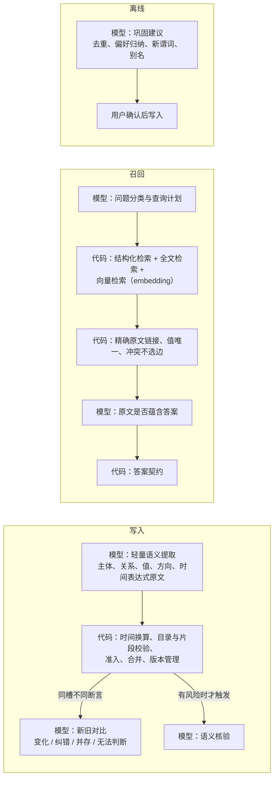

# 模型参与现状与调整建议

> 历史文档：下文保留原版本的实现描述、命令及结论，不是当前执行入口。旧写入及 legacy/local/assisted 召回已退出；当前路径、配置、备份与评测见 [架构索引](README.md)。0517000 仅作参考，不是上线门槛。

本文梳理哪些环节有模型参与、实际效果如何，以及哪些环节应该去除或削减模型、哪些环节应该加入模型。对应提交 `9f59f34`。

## 1. 哪些环节有模型参与

模型只在 4 处真正参与：写入时提取、写入时核验、legacy 模式的查询理解、assisted 模式的一次辅助。其余环节全部是规则代码。

| 环节 | 阶段名（`ModelStage`） | 模型做什么 | 输出之后怎么处理 |
| --- | --- | --- | --- |
| 写入：提取 | extraction | 把一句话拆成候选记忆，每条要填约 25 个字段（主体、类型、谓词、值、条件、两套时间、留存、两种置信度、来源、更新意图、标签等） | 本地解码，校验是否在目录内，时间由本地换算后必须与模型给的日期一致 |
| 写入：核验 | extraction_review | 对每个候选判断 9 个维度，并判断是否漏提 | 本地复核引用片段、对应关系和时间落地，通过后签发核验快照 |
| 写入：修复（可选） | extraction_repair、extraction_repair_review | 带着错误提示重新提取一次，再核验一次 | 同上 |
| legacy 召回 | query、query_review | 把问题转成主体、谓词、条件、时间等查询条件（`RuntimeContext`） | 本地规则检索，但这种模式无法核准答案 |
| assisted 召回（至多选一种） | assistance | 补充最多 3 条检索词；或拆分“问题？澄清”；或提议单关系对应哪条事实；或提议比较关系的映射 | 全部再经过本地字面核验 |
| 评测专用 | reader、judge | LongMemEval 评测中生成答案和打分 | 不在产品链路中 |

**完全没有模型的环节**：

- 实体解析：只做别名精确匹配。
- 准入、合并与版本管理。
- 结构化检索。
- local 召回里的问题理解：识别问题类型、所问属性、指代是否绑定。
- 证据核验与答案契约。

其中问题理解和证据核验，是 `src/local_recall.rs`、`src/fact_answer.rs`、`src/temporal_grounding.rs` 三个文件里约 5400 行针对中文句式的字面规则。

## 2. 实际效果

### 2.1 证据来源

仓库里留存了 11 份真实模型调用的诊断 trace，位于 `docs/refactor/s5/**/trace-*.jsonl`，使用模型 `ep-20260923215039-vxgxg`，推理强度为 medium。

**注意**：这些是开发时特意保留的问题样本，不是随机抽样，只能说明会出现哪些失败，不能当作成功率。

### 2.2 写入链路：代价高，而且不稳定

样本的输入几乎都是一句简单事实，例如“海盐折纸工作坊的报名费为36元。”，结果如下：

| 结果 | 份数 | 说明 |
| --- | --- | --- |
| 成功提交 | 3 | |
| 核验不通过，被拒绝 | 4 | “2026-10-02银杏工作坊的报名费为58元。”这类带日期的句子，核验判为不支持，候选没有核验快照 |
| 提取阶段结构化输出不合法 | 4 | 核验没有覆盖全部候选；“表达不支持却给了日期”；主体字段二选一没填对；通用 fact 没有保留完整句子 |
| 输出被截断 | 1 | 达到 16384 token 输出上限（`response incomplete: length`），其中推理只占 533 token，其余是正文 |

调用成本（摘自 trace 中的 `model_end` 事件）：

| 指标 | 观测值 |
| --- | --- |
| 每句话的模型调用次数 | 固定 2 次（提取 + 核验） |
| 单次调用耗时 | 5 到 86 秒 |
| 一句话总耗时 | 常见 25 到 150 秒，经常超过 prepare 的 45 秒等待，返回“still running” |
| 输入 token | 每次约 3300 到 3900，大部分是目录和 Schema 说明 |
| 输出 token | 核验通常是提取的 2 到 10 倍；最多一次核验用了 13934 个输出 token，其中推理占 13824 |

根本原因是结构性的：

- **Schema 太重**：一句话要填约 25 个字段，每个字段都有互斥约束，任何一处不合规，整条消息的整理就失败。
- **时间被处理了两遍**：模型要给出日期，本地还要再算一遍并要求两者一致。已知的几类失败都出在这里。
- **核验负担过重**：9 个维度里，有好几项本地也能检查（引用片段、目录、task、时间落地），却仍让模型输出大量推理。
- **提取器看不到已有记忆**：输入只有目录，不包含旧记忆，所以模型几乎不可能给出正确的 `target_memory_id`。真实的更新往往只能落到 Conflict，这是知识更新效果的主要瓶颈。

### 2.3 legacy 召回：结果不可核验

召回质量完全取决于模型选的主体、谓词和条件。选错就漏召回，而且没有原文证据通道，答案契约固定为 `unsupported_retrieval_mode`。它却仍是默认模式。

### 2.4 assisted 召回：模型能帮的忙很有限

模型给出的所有提示，最后都要通过同一套字面规则。换一种说法、字面规则识别不了的问题，模型提示也救不回来。实际上模型能增加的价值，主要是补充检索词带来的召回范围扩大。

### 2.5 规则代码：该用模型的地方反而没用

问题类型识别（`fact_answer::parse_question`、`single_relation_identity_parts`），以及关系核对（`direct_property_assertion`、`single_relation_family` 等），都是按中文句式逐条写的规则。正是它们导致放行面窄、过度拒答，而且每覆盖一种新说法都要加代码。

## 3. 建议去除或削减模型的环节

| 环节 | 建议 | 理由 |
| --- | --- | --- |
| legacy 查询理解（query、query_review） | 废弃，默认改为 local | 结果不可核验；local 已能覆盖它的作用 |
| 提取时模型给出的日历日期 | 模型只摘出时间表达式原文，日期完全交给本地换算 | 消除“两遍计算必须一致”这一类最常见的失败 |
| 提取 Schema 中的次要字段 | 去掉或改为本地推导：`retention_tier`、`extraction_confidence`、`tags`、`cross_turn_useful`、`explicit_memory_request`、`expires_at` 等 | 降低输出长度和格式失败率；这些字段的价值不足以抵消失败成本 |
| 每句都做 9 维全量核验 | 引用片段、目录、task、时间落地、覆盖范围这些能在本地检查的都移到本地；模型核验只保留“主体、关系、值、方向是否被原文支持”这类语义判断，并改为按风险触发（有更新意图、有时间、有多个主体、值不在原文中时才调用） | 核验是最贵、最慢的一步，又与本地检查大量重复 |
| assisted 的 clarification_proposal | 改为确定性拆分 | 拆分“问题？澄清”不需要模型，现有规则已经做了大部分 |

## 4. 建议加入模型的环节

按收益从高到低排：

1. **更新判定时，让模型看到旧记忆**：本地规则发现同一语义槽已有不同断言（现在直接判为 Conflict）时，把新旧两条原文交给模型，判断是现实变化、纠错、可以并存，还是无法判断，再交给现有引擎执行。这是知识更新最直接的补强。
2. **召回的语义匹配**：给原文分段和结构化记忆加向量检索，与现有全文检索融合。这一步用 embedding 模型，不需要生成式大模型，成本低，能解决换说法导致的漏召回。
3. **答案核准改为“原文是否蕴含答案”判断**：保留“必须精确链接到已提交原文、值唯一”这些硬约束，把字面关系核对换成一次小模型判断：这段原文是否支持“主体的关系是某个值”。这能替代大部分句式规则，放宽过度拒答，同时不放弃可追溯性。
4. **问题类型分类**：用一次轻量的结构化输出，把问题分为单事实、比较、聚合（计数或列举）、时间（先后、间隔）、开放咨询，并抽出主体和关系；之后由代码执行。这样可以替代 `parse_question` 这类句式规则，也是补多会话推理和时间推理的入口，见 [capabilities.md](capabilities.md)。
5. **聚合查询规划**：模型只给出查询计划（按哪个主体、谓词、时间窗口，做计数、列举还是求和），代码在结构化记忆上执行，每一项都带原文链接。这让多会话推理的结果也能被核准。
6. **离线巩固（后台批处理）**：合并重复记忆、从多条经历归纳出偏好候选、建议新增谓词、为无法解析的指代建议别名映射。结果只作为待用户确认的建议，不直接写入。这些不在实时链路上，不影响延迟。

## 5. 调整后的分工

总体原则：

- **模型负责理解和判断，代码负责记账和执行**：这条原则方向是对的，但现在两边的分工放反了。写入侧让模型填大量账目字段，召回侧却用规则做语义判断。
- **调整方向**：写入侧让模型只做轻量的语义提取和少量有针对性的判断；召回侧补上语义检索和蕴含判断，用模型替代句式规则。
- **可追溯性不能放松**：精确原文链接、值唯一、冲突不选边这些硬约束，继续由代码保证。
