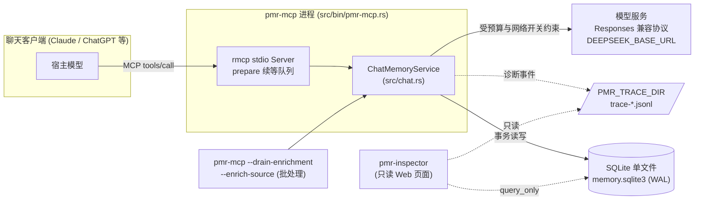
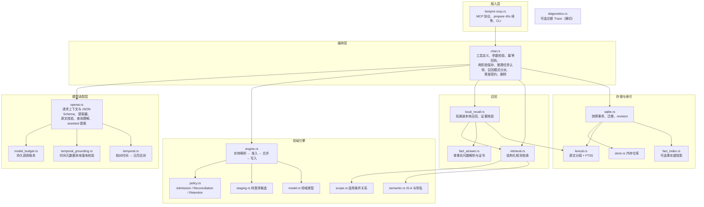
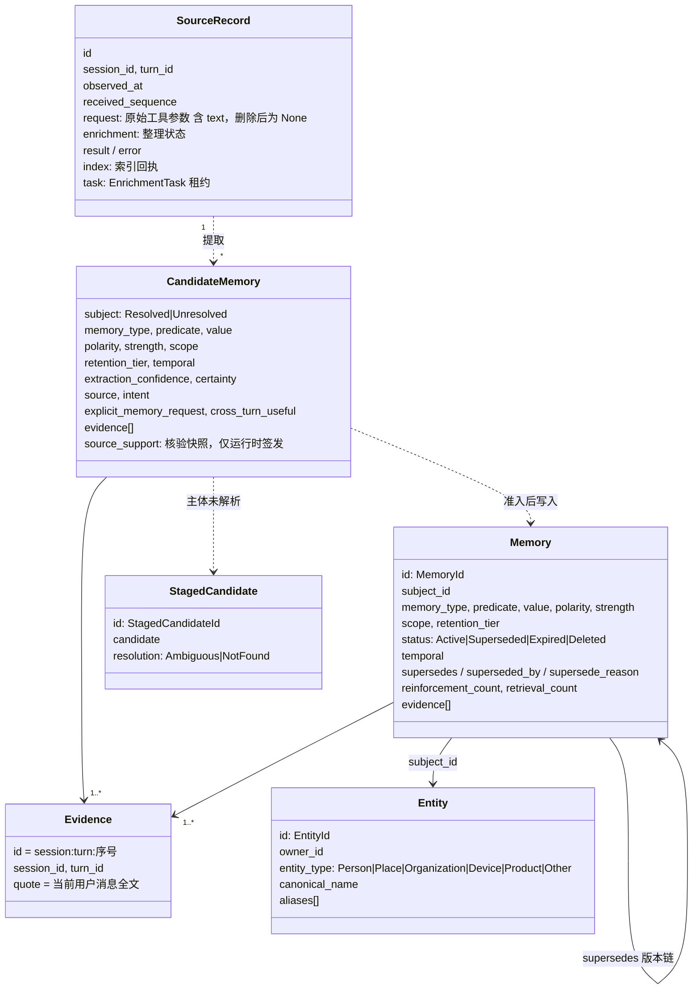
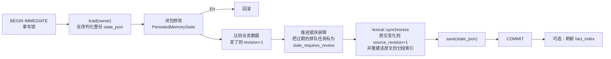
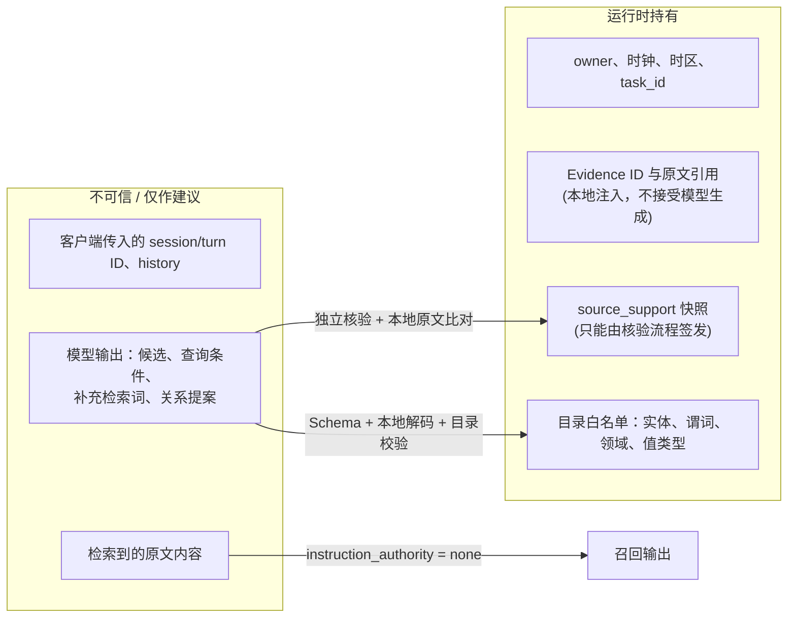

# 系统总览

## 1. 定位与边界

hippocampus 是单用户、本地优先的个人记忆运行时，目前以 stdio MCP 服务的形式接入聊天客户端。

- **管什么**：属于某个用户（owner）的个人记忆。被描述的主体（subject）可以是用户本人，也可以是孩子、设备、项目等实体。
- **不管什么**：目标、计划和项目进度不作为已发生的事实入库。没有知识图谱或完整本体，只维护显式注册的 IS-A 类别边（如 `latte → coffee`）。
- **一个进程服务一个 owner**：`pmr-mcp --owner` 在启动时固定用户身份。数据库、时钟和语义目录都由服务端持有，客户端无法指定。

## 2. 部署形态

| 可执行程序 | 作用 |
| --- | --- |
| `pmr-mcp` | MCP 服务（默认）。也可作为批处理 CLI 运行：`--drain-enrichment --max-jobs N` 处理 deferred 队列，`--enrich-source ID` 处理指定原文 |
| `pmr-inspector` | 独立的 workspace 包（`inspector/`），只读 SQLite、日志和 Trace，提供本机 Web 页面，不执行记忆操作，也不调用模型 |

并发模型：MCP 层用 tokio 接收请求，但 `ChatMemoryService` 放在一个 `Mutex` 里，所有工具调用串行执行，模型请求走阻塞的 reqwest。不同进程共享同一个 SQLite 文件时，靠 `BEGIN IMMEDIATE` 写锁加“锁内重读最新快照”避免互相覆盖。

## 3. 模块分层

各层职责的核心约定是：**模型只提出，代码来裁决**。模型负责理解自然语言，输出候选记忆、查询条件或检索提示；Rust 代码负责校验字段与目录、换算时间、解析实体、准入、幂等、版本管理、匹配、冲突检测和事务持久化。代码无法识别格式合法但语义错误的模型输出，所以写入侧另有一次独立的模型核验，召回侧另有字面级的原文链接校验。

## 4. 数据模型

### 4.1 一条记忆的关键维度

| 维度 | 取值 | 作用 |
| --- | --- | --- |
| `MemoryType` | Fact / Preference / Constraint / Episode | Constraint 用于过滤，Preference 用于排序，二者不合并成一个分数 |
| `predicate` + `Cardinality` | Single / Multiple | 决定“语义槽”（semantic slot）：Single 槽同一时刻只有一个值，Multiple 槽按值区分 |
| `Scope` | 可选 `domain` + 条件集合（Companion / Location / Time / Activity / Task） | 适用条件，不是自由文本。条件越多越具体，更具体的规则覆盖更一般的规则 |
| `Temporal` | `observed_at`、`valid_from`、`valid_to`、`expires_at`、`reference` | 把“系统何时得知”“现实中何时成立”“系统何时淘汰”分开记录；事件相对时间或无法理解的时间放在 `reference`，不伪造时间戳 |
| `RetentionTier` | ShortTerm / LongTerm / Durable | 留存层级。ShortTerm 经过两次独立强化或用户明确要求后升为 LongTerm；Durable 不会自动过期 |
| `MemoryStatus` | Active / Superseded / Expired / Deleted | 只描述已入库记录。Pending、Rejected、Conflict 都不算入库 |
| `extraction_confidence` 与 `certainty` | Low / Medium / High | 前者是系统是否理解对了原话，后者是用户自己有多确定。两者独立 |
| `reinforcement_count` 与 `retrieval_count` | 计数 | 只有新的用户证据才算强化；被召回的次数不参与留存升级，防止系统自我强化 |

### 4.2 默认语义目录

`ChatConfig::default()`（`src/chat.rs:78`）内置的谓词包括：`lives_in`、`works_at`、`job_title`、`response_language`、`code_example_language`（Single），以及 `response_style`、`likes`、`avoids`、`allergic_to`、`owns`、`uses`、`visited`、`fact`（Multiple）。`fact` 是通用槽，要求 value 必须是原文中一个完整的用户句子。启动时会自动注册实体 `self`（“用户本人”，别名“我/自己/本人/I/me”）。

## 5. 存储

所有数据存在一个 SQLite 文件里，`PRAGMA user_version = 5`，启用 WAL 和 `synchronous=FULL`，文件权限为 0600。

| 表 | 内容 | 性质 |
| --- | --- | --- |
| `memory_profiles(owner_id, state_json)` | 每个 owner 一整份 JSON 快照（`PersistedMemoryState`）：记忆仓库、实体、待澄清候选、幂等回执、原文记录、revision 计数 | **权威数据** |
| `source_indexes` / `source_segments` / `source_fts` | 原文按 768 字符分段（重叠 128 字符），建立 FTS5 索引；中文按单字编码、英文按词编码 | 可重建的投影 |
| `fact_indexes` | 可选的已提交事实键投影（`fact_index_enabled`），用于给原文片段补充检索词 | 可重建的投影 |
| `model_budget_groups` / `model_calls` | 模型调用授权策略与逐次调用账本，跨重启累计 | 独立账本 |

### 5.1 快照事务

`SqliteMemoryStore::transaction`（`src/sqlite.rs:299`）是所有写操作的唯一入口：

- **两个 revision**：`revision` 在记忆、实体或待澄清候选变化时递增，`source_revision` 在原文变化时递增。召回结果会带上这两个值，用于判断结果之后是否过期。
- **顺序屏障**：`last_applied_source_sequence` 与 `source_less_barrier_sequence` 保证较早接收的原文在异步整理时，不会覆盖之后已经生效的更改。
- **规模边界**：每次读写都要处理整份 JSON，召回也要遍历该用户的全部记忆。代码中多处 `ponytail:` 注释标明了这一点，数据量变大后需要改成按记录存储并加字段索引。

## 6. 配置与运行模式

配置由 `--config` 指定的 JSON 文件提供（`ChatConfig`），未知字段或重复字段会直接报错。

| 配置项 | 取值（**默认值**） | 含义 |
| --- | --- | --- |
| `retrieval_mode` | **legacy** / local / assisted | 召回路径，见 [recall-path.md](recall-path.md)。旧字段 `local_recall_enabled=true` 等价于 local |
| `enrichment_mode` | **inline** / deferred / off | 整理方式：inline 在当前请求内整理；deferred 只入队，由批处理 CLI 整理；off 只保存原文 |
| `source_capture_enabled` | **true** | 是否接受 `capture_source=true` 的原文保存 |
| `fact_index_enabled` | **false** | 实验性事实键索引 |
| `model_budget` | 无 | 调用模型的前提。包括 `group_id`、`max_calls`（总次数）、`max_operation_calls`（单次操作最多几次，1 到 4）、是否允许纠错重提取，以及输入、输出上限 |
| `local_recall_budget` | candidate_k=30, source_limit=10, content_bytes=24000 | 本地召回的候选数量、原文条数和内容字节预算 |
| `utc_offset_seconds` | **28800**（UTC+8） | 解析日历边界用的时区 |
| `predicates` / `domains` / `value_kinds` / `memory_types` / `is_a` | 见 4.2 | 语义目录，同时约束模型输出的 Schema 和本地解码 |

环境变量：

| 变量 | 作用 |
| --- | --- |
| `DEEPSEEK_BASE_URL`、`DEEPSEEK_API_KEY` | 模型端点与凭据 |
| `PMR_MODEL_NETWORK` | `offline`（默认，只允许本机回环地址）/ `deny` / `live` |
| `PMR_TRACE_DIR` | 开启诊断 Trace，输出 `trace-*.jsonl`，供 Inspector 读取 |
| `PMR_OPENAI_TRACE`、`PMR_OPENAI_TRACE_CONTENT` | 在 stderr 打印模型调用摘要，可选打印模型原始输出 |

**模型调用预算**（`src/model_budget.rs`）：每次发送前，先在账本中以事务方式预留一条记录，并检查三项上限：分组总次数、单次操作的次数，以及同一操作内每个阶段最多调用一次。阶段包括 extraction、extraction_review、extraction_repair、extraction_repair_review、query、query_review、assistance。请求失败不退还额度，也没有自动重试。

## 7. MCP 工具

| 工具 | 读/写 | 是否可能调用模型 | 作用 |
| --- | --- | --- | --- |
| `memory_recall(bootstrap=true)` | 读（会写召回计数） | 否 | 新会话第一步：加载全局约束与回答语言、风格 |
| `memory_prepare` | 写 + 读 | 是 | 日常入口：先保存当前用户消息，再用同一句话召回 |
| `memory_remember` | 写 | 是 | 只保存 |
| `memory_recall` | 读（legacy 模式会写召回计数） | 视模式而定 | 只召回，不把问题当作证据 |
| `memory_validate_answer` | 读 | assisted 模式可能调用 | 核准宿主改写后的答案草稿 |
| `memory_list` | 写（执行到期迁移） | 否 | 列出记忆 ID、状态、待澄清项与实体 |
| `memory_entity_upsert` | 写 | 否 | 注册或更新实体及别名 |
| `memory_clarify` | 写 | 否 | 用用户澄清解决一个待澄清候选 |
| `memory_forget` | 写 | 否 | 按记忆、待澄清项或原文删除，关联数据一并删除 |

每个响应都会附带 `global_context`：从本地快照读出的当前全局要求（全局 Durable 约束、回答语言、风格）。它的读取成败不影响主操作的结果。

客户端调用约定见 `docs/memory-client-contract.md` 与 `docs/personal-memory-instructions.md`。后者同时作为 MCP `instructions` 下发。

## 8. 信任边界

- **证据归运行时所有**：Evidence 的 ID、session、turn 和 quote 由本地注入，模型无法伪造。
- **核验快照绑定整个候选**：`source_support` 保存的是候选全部字段的快照。候选任一字段被改，快照即失效；从 JSON 反序列化出来的候选永远不带核验快照，只有 SQLite 中受信任的待澄清记录能恢复。
- **原文只是数据**：召回返回的原文都标记 `instruction_authority: none`，客户端不得把其中的内容当作指令执行。
- **答案放行需要链接**：只有精确链接到已提交原文、当前快照中值唯一的事实，才能得到 `source_linked_fact` 或 `source_linked_exact_identity`。其他情况只给出保守答复。

## 9. 可观测性

| 手段 | 内容 |
| --- | --- |
| `IngestTrace` | 每个候选的准入检查明细、看到的旧记忆、匹配到的语义槽、合并决策及原因 |
| `RetrievalResult.trace` | owner 范围内每条记忆的最终决策：Mandatory、Selected、Filtered（记录首个失败阶段）或 Conflict |
| 本地召回输出 | `source_decisions`、`degraded_reasons`、`budget.excluded`、`conditions_provenance` |
| `model_calls` | 本次操作中每次模型调用的阶段、结果与用量 |
| 诊断 Trace | 开启 `PMR_TRACE_DIR` 后记录 run_start/run_end、事务前后快照、候选决策、检索、模型请求与响应。写入失败只标记 `evidence_incomplete`，不影响业务结果 |
| Inspector | 以只读方式展示上述内容，以及原文回执和记忆版本 |
