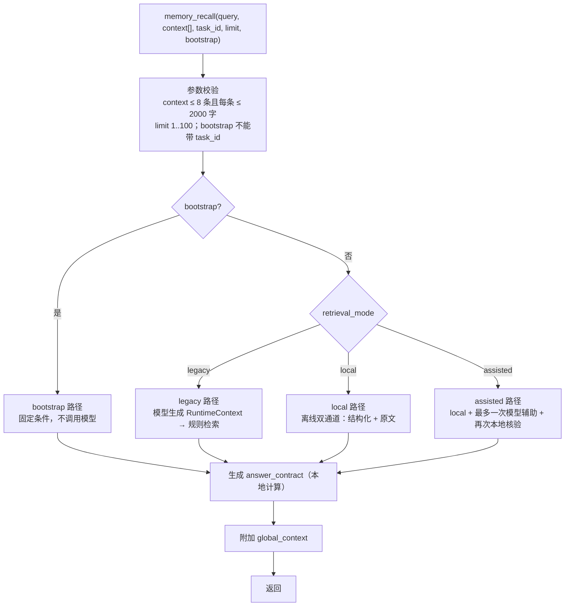
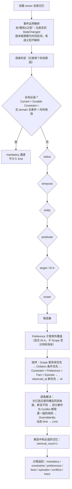
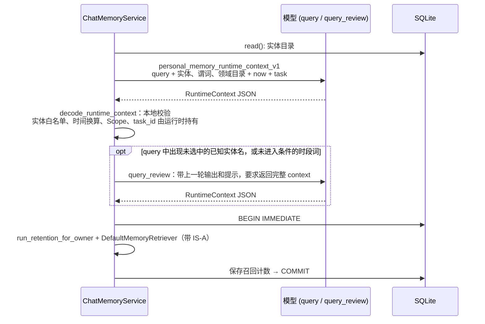
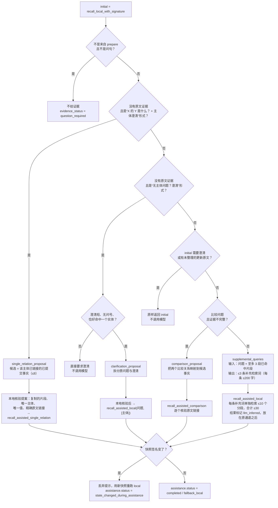
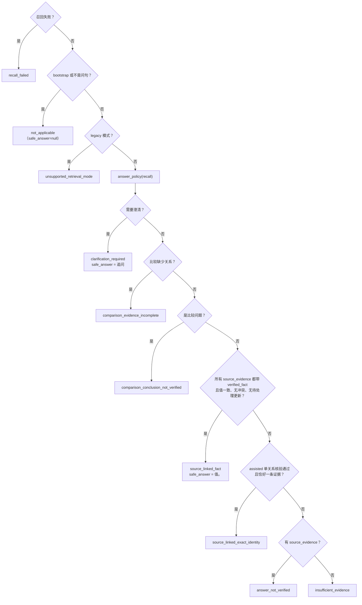

# 召回记忆流程

本文描述一个问题如何找回相关记忆，以及系统如何决定哪些内容可以作为答案依据。入口有四个：`memory_recall`（普通或 bootstrap）、`memory_prepare` 的召回部分、`memory_validate_answer`，以及每个响应都附带的 `global_context`。

## 1. 入口与模式分派



`memory_prepare` 保存完成后，会用同一句用户消息作为 `query`、`history` 作为 `context`，以 `from_prepare=true` 在内部调用 `memory_recall`。原文被拒绝时不执行召回。

| 模式 | 是否调用模型 | 是否写库 | 能否核准答案 |
| --- | --- | --- | --- |
| bootstrap | 否 | 是（写召回计数和到期状态） | 不适用（`not_applicable`） |
| legacy（默认） | 是：query，可能加 query_review | 是（写召回计数和到期状态） | 否（`unsupported_retrieval_mode`） |
| local | 否 | 否（在快照副本上计算） | 能 |
| assisted | 至多一次 assistance 调用 | 否 | 能 |

## 2. 核心：结构化规则检索 `DefaultMemoryRetriever`

四种模式都会用到它（`src/retrieval.rs:136`）。输入是 `RuntimeContext`：owner、domain、entities、task_id、conditions、predicates、targets、temporal_intent（Current / Historical）、temporal_filter、at、limit。



各过滤阶段的语义：

| 阶段 | 规则 |
| --- | --- |
| status | Current 只要 Active；Historical 可以读 Superseded 和 Expired，但**不读因纠错（Correction）被替换的版本**，因为纠错说明旧值从未成立 |
| temporal | 有区间则判断是否相交；有事件引用则要求完全相同；Historical 且无过滤条件时，读取截至 `at` 已成立的记录，未知时间只接受“以前”“曾经”这类泛指过去的表达；Current 且无过滤条件时按 `at` 做点查询 |
| entity | query 给了 entities 时，subject 必须命中，或 Scope 中同行者引用了该实体 |
| predicate | query 给了谓词白名单时必须命中 |
| target | 对 Preference 和 Constraint：target 与 value 相同，或 target IS-A value（禁止 Coffee 的规则覆盖 Latte）；关系不做反向推理；Episode 只做身份匹配；Fact 不按 target 过滤 |
| scope | `Scope.applies_to`：domain 必须一致；所有条件都要被 query 的条件蕴含（AND 语义）。对话中提到、但没有进入 context 的条件不算满足 |

冲突规则：同一语义槽、同样具体、断言不同的两条记录，**两条都不返回**，只在 `conflicts` 中报告，避免随机把其中一方交给模型。Historical 查询中有效期互不相交的历史版本不算冲突，可以同时返回。

## 3. bootstrap 路径

新会话第一步调用，完全在本地执行：

```text
RuntimeContext::current(owner, now)
  entities   = [self]
  predicates = [response_language, response_style]
  limit      = 请求中的 limit
→ 写事务内：run_retention_for_owner → DefaultMemoryRetriever.retrieve
```

结果 = 全局必返的 Durable Constraint + 用户本人的回答语言和风格。

## 4. legacy 路径



这条路径的召回质量完全取决于模型选的主体、谓词和 Scope。选错就会漏召回，而且没有原文证据通道。在这种模式下，对问题的答案契约固定为 `unsupported_retrieval_mode`。

## 5. local 路径（离线双通道）

入口是 `SqliteMemoryStore::recall_local`，核心函数为 `recall_local_snapshot`（`src/local_recall.rs:1376`）。整个过程在**同一个 SQLite 读快照**中完成，只在快照副本上执行到期迁移和计数，不写回数据库。

```mermaid
flowchart TD
    S0["读快照 + 快照签名<br/>(owner, at, revision, source_revision,<br/>索引元数据, fact_index 清单)"] --> S1

    subgraph P["① 查询解析（确定性，不调用模型）"]
        S1["拆分“问题？澄清”形式"] --> S2["natural_phrases：中文相邻两字 + 英文词 + 已注册别名"]
        S2 --> S3["entity_hints：query 和 context 中字面命中的实体"]
        S3 --> S4["识别问题类型：单事实问题 fact_question、<br/>比较、技术选型、因果、时间、动词关系、<br/>所问属性、未注册主体"]
        S4 --> S5["指代检查：出现“那它”等指代，<br/>或问句缺少主体绑定 → needs_clarification"]
    end

    S5 --> ST
    subgraph SC["② 结构化通道"]
        ST["runtime = 可信上下文 + 从问题中落地的活动条件<br/>limit = ∞（先看全部同槽记录，避免数量限制掩盖冲突）"] --> ST2["retention + DefaultMemoryRetriever"]
        ST2 --> ST3["恢复原计数（只读）"]
    end

    ST3 --> BL
    subgraph RV["③ 更正与撤回拦截"]
        BL["扫描更新的原文：含“更正、撤回、改为、不再”等<br/>→ 把被它修订的当前记忆放入 blocked_current_ids"]
        BL --> BL2["同一主体有尚未整理完的新原文<br/>→ uncommitted_newer_revision"]
    end

    BL2 --> FT
    subgraph RW["④ 原文通道"]
        FT["search_source_snapshot：FTS5 按短语 OR 匹配<br/>排序：实体命中数 → 短语命中数 → context 实体命中数 → 越新越前<br/>取 candidate_k=30 个分段"] --> FT2["memory_links：分段中精确出现的<br/>证据原文 → exact_quote 链接到记忆"]
        FT2 --> FT3["可选：fact_index 为分段补充事实键"]
    end

    FT3 --> VF
    subgraph VE["⑤ 证据核验"]
        VF{"问句？"}
        VF -- 是 --> Q1["分段必须：原文已整理提交、链接确定、没有更新的未整理原文、<br/>exact_quote 链接到一条 Selected 或 Mandatory 记忆、<br/>主体与关系在字面上成立、不含其他同类实体<br/>→ source_linked_quote<br/>（值在快照中唯一时附 verified_fact）"]
        VF -- 否 --> Q2["按主体、属性过滤<br/>其余作为 unverified_source_statement；<br/>链接到非当前记忆的，放入 historical_or_conflicting"]
    end

    Q1 & Q2 --> AS
    subgraph BG["⑥ 预算装配"]
        AS["优先：全局必返 → 冲突与历史 → Constraint"] --> AS2["原文证据与结构化记忆交替装入<br/>source_limit=10，content_bytes=24000，结构化最多 limit 条"]
        AS2 --> AS3["比较问题缺少任一关系 → 清空证据<br/>comparison_evidence_incomplete"]
    end

    AS3 --> OUT["⑦ 输出<br/>result / source_evidence / historical_or_conflicting /<br/>global_context / reference_resolution / evidence_status /<br/>degraded_reasons / source_decisions / budget / conditions_provenance"]
```



### 5.1 关键判断

- **相关性**（`relevant`）：属于全局要求（用户本人、无 Scope 的 Durable Constraint 或回答语言、风格），或同时满足三点：主体匹配、关系匹配、记忆的值或证据原文命中查询短语。无法作答（指代有歧义、需要澄清）时，只保留全局要求。
- **关系匹配**（`relation_matches`）：按识别出的问题类型选择对应的字面检查器，例如 `direct_property_assertion`、`fact_answer::verify`、`direct_cause_assertion`、`direct_time_assertion` 等。只做字面匹配，不做语义等价推断。
- **单事实证书**（`fact_answer.rs`）：解析“X 的 Y 是多少/什么”一类问题，包括数量、费用、用法、活动、默认设置等有限句式。只有在原文是一句完整断言、值在当前快照中唯一、且没有待处理的更新时，才给出 `verified_fact`。
- **原文只是数据**：所有原文输出都带 `instruction_authority: none`；没有精确链接到当前记忆的原文，一律标记为未经核验。

### 5.2 `evidence_status` 与 `degraded_reasons`

| 值 | 含义 |
| --- | --- |
| `evidence_status = sufficiency_not_verified` | 正常结果。找到了证据，但不保证足够回答问题 |
| `clarification_required` / `ambiguous` | 主体无法绑定，需要先追问 |
| `uncommitted_newer_revision` | 有更新的原文还没整理完，当前事实可能已经过时 |
| `default_setting_overridden` | 问的是默认设置，但存在适用的当前设置 |
| `degraded_reasons` | `structured_enrichment_incomplete`、`lexical_coverage_incomplete`、`fact_index_unavailable`、`context_budget_incomplete`、`candidate_quota_reached`、`comparison_evidence_incomplete` 等 |

## 6. assisted 路径

assisted 模式先执行一次 local 召回，并保存快照签名；再根据情况**至多选择一种**模型辅助；最后用同一套本地规则重新核验。如果辅助期间快照签名变了，就丢弃模型给出的提示。



要点：

- 补充检索词只能扩大原文检索的范围，得到的片段仍要通过第 5 节 ⑤ 的全部核验，而且不能挤占原始检索结果的预算。
- 关系提案和比较提案给出的语义判断，会被标注为 `semantic_judgment: model_proposed`、`answer_sufficiency: not_verified`。
- 模型调用失败、预算不足或网络关闭时，回退到本地结果（`fallback_local`），召回本身不失败。

## 7. 答案契约与最终核准

### 7.1 `answer_contract`（每次问题召回都会附带）

由 `call_in_operation` 在本地计算（`src/chat.rs:2207`），不调用模型：



契约字段：`version=1`、`query`、`context`、`task_id`、`status`、`safe_answer`、`safe_source_ids`、`sources`（引用编号、原文和证据等级 `grade`）、`read_revision`、`source_revision`。允许引用来源的状态有 `source_linked_fact`、`source_linked_exact_identity`，以及 assisted 模式下本地规则核准不了时由模型答案检查给出的 `source_linked_model_answer`（答案是原文逐字片段）和 `source_linked_computed_elapsed`（模型给出事件日期，代码计算间隔）；其他状态下，客户端应原样使用 `safe_answer`。

证据等级只做标注，不做分支（见 `roadmap.md` 3.4）：`committed` 表示原文已整理进记忆，`uncommitted` 表示原文已保存但尚未整理。模型答案检查两类原文都可以引用，是否为同一主体、是否被后来的话更正、是不是提问或假设，都由模型判断；代码只核验答案是原文的逐字片段、来源归属和任务范围。

### 7.2 `memory_validate_answer`

宿主想改写或扩写答案时调用：

1. 校验输入，非问句直接返回 `question_required`，legacy 模式返回 `unsupported_retrieval_mode`。
2. 用完整原问题重新执行一次召回（assisted 模式可能调用模型）。
3. `final_answer_gate`：`approved = true` 需要同时满足两点：
   - 草稿引用的 `source_ids` 与 `safe_source_ids` 完全相同；
   - 草稿与 `safe_answer` 逐字相同。唯一的例外是 `source_linked_exact_identity` 状态下，允许一种受限的自然句式：“{主体}{修饰}的是 {值}。”

所以核准范围很窄：它能拦住编造和扩大结论，但宿主若不调用校验、直接改写，MCP 无法强制阻止。这是已登记的已知限制。

## 8. global_context

每个工具响应都会附带 `global_context`，由 `ChatMemoryService::global_context()` 从本地快照计算：只取用户本人的、无 domain 和条件的记忆，放到一个临时仓库里执行到期迁移和 bootstrap 检索，报告已持久化的计数，不做任何修改。local 和 assisted 召回直接复用本次读快照中计算出的全局结果。读取失败只返回 `status: unavailable`，不影响主操作。

## 9. 一致性保证小结

| 机制 | 保证 |
| --- | --- |
| 单一读快照 | local 召回中，结构化通道、原文通道和事实索引看到的是同一个版本 |
| 快照签名 | assisted 模式调用模型前后比较签名，数据变了就丢弃模型提示 |
| `read_revision` / `source_revision` | 答案契约绑定到具体数据版本；`validate_prepare_response` 据此丢弃过期的 prepare 召回 |
| 更正拦截与待整理检测 | 存在更新的更正原文或未整理原文时，旧事实不能作为当前答案放行 |
| 冲突不选边 | 同槽同具体度的矛盾记录两条都不返回，只报告冲突 |
