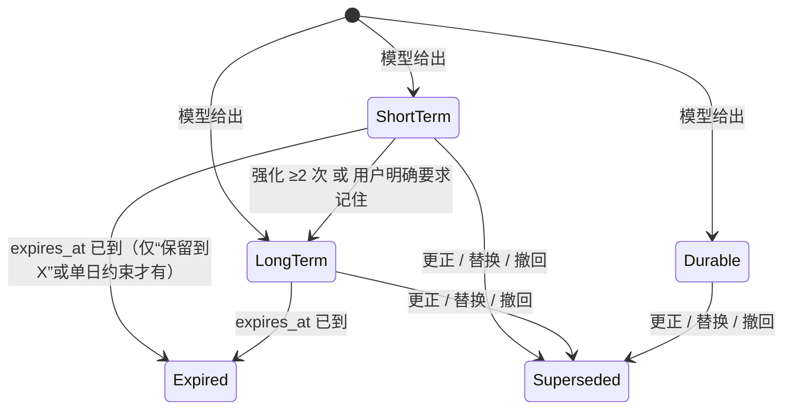

# 记忆留存：升级与失效

本文说明短期、长期记忆的升级和失效在当前代码中如何实现，对应提交 `a70a38a`。

先给结论：留存层级基本只是一个标签。唯一真正会让记忆“过期”的是截止时间 `expires_at`，而它只在两种很窄的情况下才会被设置。系统没有“中期”这一层，也没有“升级为事实”的机制。

## 1. 层级是怎么定的

`RetentionTier` 只有三档：`ShortTerm`、`LongTerm`、`Durable`（`src/model.rs:240`）。如果要对应“中期”，最接近的是 LongTerm。

- **初始层级完全由提取模型填写**（`retention_tier` 字段）。提示词中有少量指引：
  - 他人近期态度的临时观察、刚开始还没稳定的活动，标为 ShortTerm；
  - 只在今天适用的规则，标为 ShortTerm，并加一个日期条件。
- 本地只把模型给的值原样转换过来（`src/openai.rs:2276`），不做任何推导。
- 候选里带的层级只在**新建**记忆时生效。之后新来的候选即使声明了更高层级，也不会直接改已有记忆，统一由留存策略判断。

## 2. 升级：只有“短期 → 长期”一条路

规则只有一条（`DefaultRetentionPolicy`，`src/policy.rs:358`）：

```text
Active 且 ShortTerm，并满足以下任一条件 → 升为 LongTerm：
  · reinforcement_count >= 2（被两次独立的新消息强化）
  · explicit_memory_request = true（用户明确说了“记住/保存”）
```

### 2.1 什么算一次“强化”

必须同时满足以下条件，引擎才会走 Reinforce 并把计数加一（`src/engine.rs:438`）：

- 同一语义槽：主体、类型、谓词相同；多值谓词还要求值相同；
- 适用条件（Scope）完全相同；
- 断言相同：值、正负方向、强度都一致；
- 来自**另一轮**消息。同一轮消息重复提交会判为 Duplicate，不计数。

另外，模型的更新意图必须是普通断言（Assert）。被召回的次数（`retrieval_count`）刻意不参与升级，防止系统自我强化。

### 2.2 什么时候检查升级

- 强化发生时，当场检查一次；
- 执行 `run_retention_for_owner` 时，对全部记忆扫一遍（触发时机见第 4 节）。

### 2.3 没有的升级路径

| 期望的升级 | 现状 |
| --- | --- |
| LongTerm → Durable | **没有**。Durable 只能由提取模型在新建时直接给出 |
| 多条经历归纳成事实或偏好（Episode → Fact / Preference） | **没有**。`memory_type` 从新建起就固定，没有归纳或巩固过程 |
| 按时间沉淀，例如“持续成立 N 天后自动转为长期” | **没有** |
| 近义说法累计强化 | **没有**。说法稍有不同，值就对不上，会得到 New 或 Conflict，计数不会增加 |

## 3. 失效：五种机制

只有第一种由留存策略负责，其余四种来自时间过滤、版本管理、删除和召回拦截。

### 3.1 留存到期：`expires_at`

留存策略规定：**非 Durable** 的 Active 记忆，只要 `expires_at <= now`，状态就改为 Expired（`src/policy.rs:365`）。不做物理删除，历史查询仍能读到。

但 `expires_at` 只有两个来源：

| 来源 | 例子 | 截止时间 |
| --- | --- | --- |
| 用户明确给出保存期限 | “保留到明天” → `memory_request.kind = retain_until`，同时要求 `explicit_memory_request = true` | 所保留那一天结束后的本地零点（`src/openai.rs:2223`） |
| 只在某天适用的短期约束 | ShortTerm 的 Constraint，且条件里带具体日期 | 那一天结束时（`src/openai.rs:2278`） |

**关键问题**：除这两种情况外，ShortTerm 记忆**没有任何默认有效期**，会永远保持 Active。“短期”和“长期”在失效行为上其实完全一样。召回排序也不看层级，只有 Durable 的全局约束会进入必返通道。

**一个值得注意的交互**：“保留到明天”会设置 `explicit_memory_request = true`。如果这条记忆是 ShortTerm，下次执行留存检查时就会被升为 LongTerm，但 `expires_at` 不会被清除，所以明天照样过期。升级不会延长截止时间。

### 3.2 现实有效期结束：`valid_to`

这一种不改变状态。记忆仍是 Active，但当前查询按时间点判断是否有效（`Temporal::valid_at`，`src/model.rs:353`）：

```text
reference 为空，且 valid_from <= 查询时间 < valid_to
```

例如“下个月出差”这类区间，时间过了自然就不会出现在当前查询里，但历史查询仍能读到。

**副作用**：`reference` 不为空的记忆，也就是事件相对时间（如“旅行结束后”）或无法理解的时间，`valid_at` **永远为 false**。它们在当前查询中始终不可见，只能在历史查询中出现。

### 3.3 被替换或撤回

用户说了更正、状态变化或撤回，并且提取模型给出了对应的更新意图时，旧版本变为 Superseded，并写入 `valid_to`（`src/engine.rs:589`）。因纠错被替换的旧版本，历史查询也读不到。详见 [write-path.md](write-path.md) 第 8 节。

### 3.4 删除

`memory_forget` 把记忆改为 Deleted（软删除），同时删除原文，并连带删除同一轮消息派生出的其他记忆。详见 [write-path.md](write-path.md) 第 12 节。

### 3.5 召回时临时拦截

这一种不改数据库。如果存在更新的原文，其中含“更正、撤回、改为、不再”等字样，或者该主体有尚未整理完的新原文，local 召回会把相关的旧记忆排除在当前答案之外（`src/local_recall.rs:1691`）。

## 4. 留存检查什么时候执行，结果是否保存

系统没有后台定时任务，留存检查都是在别的操作里顺带执行的：

| 触发点 | 是否把 Expired 或升级结果写回数据库 |
| --- | --- |
| legacy 模式召回、bootstrap 召回 | 是 |
| `memory_list` | 是 |
| 强化发生时 | 是，只针对被强化的那一条 |
| local 或 assisted 召回 | **否**，只在快照副本上计算 |
| `global_context` | **否**，只在临时副本上计算 |

所以在 local 模式下，查询结果本身是对的，因为每次都会现算。但数据库里的状态可能长期停在 Active，要等有人调用 `memory_list` 或 bootstrap 才会更新。Inspector 看到的是持久化的状态，可能与实际不一致。

## 5. 状态总览



图中 ShortTerm、LongTerm、Durable 是留存层级，Expired、Superseded 是记忆状态；两者在代码里是两个独立字段，这里画在一起只为说明流转。现实有效期结束（3.2）和召回拦截（3.5）不改变任何字段，因此没有画出。

## 6. 主要问题

1. **ShortTerm 没有默认有效期**，“短期”形同虚设。
2. **层级不影响召回**：除 Durable 的全局约束外，排序和过滤都不看层级。
3. **没有通往 Durable 的升级，也没有从经历到事实的归纳。**
4. **强化门槛过严**：要求字面完全一致，还依赖模型判为普通断言。
5. **失效状态不及时写回**：没有后台任务，local 模式下 Expired 状态可能一直不落库。
6. **带事件引用的记忆在当前查询中不可见**：`reference` 不为空时，`valid_at` 永远为 false。

## 7. 建议方向

- **给 ShortTerm 设默认有效期**：例如 14 到 30 天可配置，被强化时顺延。这样“短期”才真正有意义。
- **召回排序加入层级和新鲜度**：层级、最近一次强化时间一起作为排序依据，同时保持“约束用于过滤、偏好用于排序”的分离。
- **加一个离线巩固任务**，负责：
  - 扫描到期的记忆，并把状态写回数据库；
  - 对语义相近的记忆合并强化计数，需要模型或向量相似度判断，并记录依据；
  - 从多条经历中归纳出偏好或事实候选；
  - 提出“升为 Durable”的建议。

  后两项只作为建议，经用户确认后才写入。与模型分工的关系见 [model-usage.md](model-usage.md) 第 4 节。
- **处理带事件引用的记忆**：对 `reference` 不为空的记忆，至少让它在当前查询中以“时间未知”的标注出现，而不是完全不可见。
