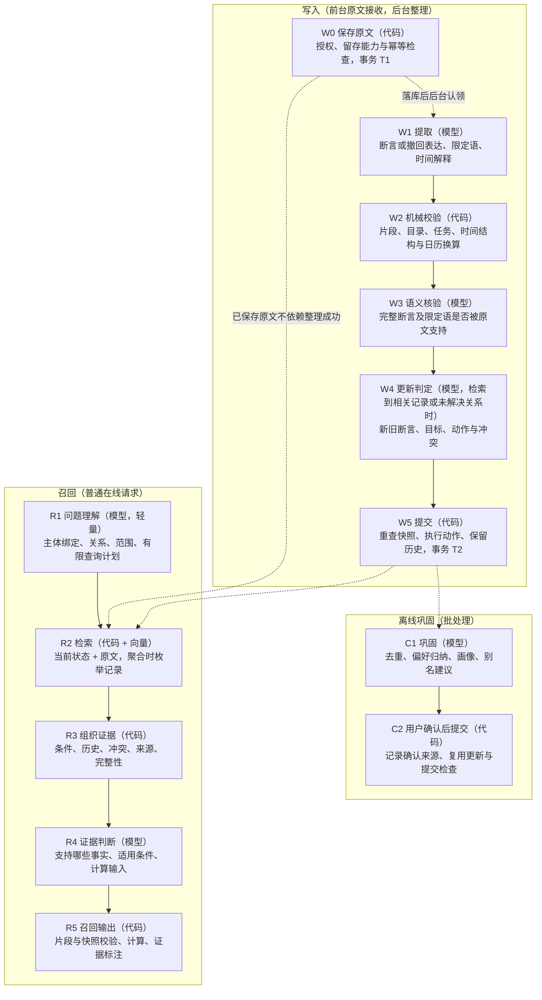

# 目标架构设计（已冻结）

> M1 收尾状态（2026-10-06）：默认新路径，旧执行器已删除、旧数据读取保留；历史合并 59/4，当前严格回放仍有 59 个缺口。实现、备份、局限与补录授权见 [架构索引](README.md)。M1.5 按 AF41 增加计划记忆并升版；来源确认/重建与历史补录分别在第③④步实现。

本文确定 hippocampus 重构的主流程、最小数据契约、模型参与点、状态变化和验收方式。先定契约与首批验收样本，再分段实现；减少因主流程反复变化而产生的真实模型重录。离线回放仍作为常规回归检查。

本文描述冻结目标行为；当前实现范围见 [w4-code-side.md](w4-code-side.md) 与 [recall-runtime.md](recall-runtime.md)，旧 overview/write-path/recall-path 已标历史。完整负载延迟目标仍未完成验收。原设计日期：2026-09-30。

第一阶段的具体字段、核验和迁移退出条件见 [contracts.md](contracts.md)；契约已于 2026-09-30 冻结，当前编号为 `w1.v2`、`w3.v2`、`w4.v4`、`r1.v1`、`r4.v5` 与宿主 `recall.v5`（计划语义及各次变更见 contracts.md 第 8 节）。

原则沿用 [../roadmap.md](../roadmap.md) 第 3 节，并明确以下约束：

- **以原文为本**：用户原话是事实来源；结构化记忆和检索索引是可重建的整理结果。用户确认、实体登记和删除决定也必须独立保留，重建不得覆盖这些控制记录。
- **模型理解语义，代码记账和执行**：代码检查片段、归属、目录、任务、快照和算术；主体绑定、断言支持、条件适用、时间含义和更新关系由模型判断，不继续增加中文句式特判。
- **系统负责整理，宿主负责表达**：系统提供当前事实、条件、历史、冲突和来源，宿主组织回答。证据等级只做标注，不作为额外的答案放行分支。
- **降低模型能力时优先保守降级**：逐字片段不能证明语义正确，机械校验也不能保证弱模型只会增加弃答。语义错误、弃答、成本和延迟必须分别评测。
- **局部失败不能扩大断言含义**：装饰性字段可以丢弃；主体、关系、否定、不确定性、条件、时间和用户指定留存期限不能因解析失败而静默删除。独立候选分别处理，有依赖的更新动作一起提交。

## 1. 主流程与数据契约

### 1.1 主流程

W0 在前台保存获准原文与全文索引，完成 T1 后即可召回，不等待 W1—W5 的后台整理。W4 在同一后台整理任务内、W5 提交前完成；无需 W4 时，W3 通过的独立新断言可直接进入 W5。模型调用都在数据库写事务之外，也不得持有阻塞前台的服务全局锁。bootstrap 和完全离线路径见 2.5，不经过 R1、R4。图中 W0 的“留存能力检查”指目标状态；第一阶段由宿主按 1.3 的临时调用规则执行，服务端保存限制参数在第一阶段之后补齐。

### 1.2 最小数据契约

以下是需要冻结的逻辑契约，不要求为每项新建表或抽象层；优先沿用现有存储和事务。

| 契约 | 必须表达的内容 | 权威性与变化方式 |
| --- | --- | --- |
| 原文与控制记录 | 原文 ID、用户/会话/轮次、接收时间与顺序、独立陈述时间（补录未知可空）、父来源/条目出处与代际（③④实现）、获准保存范围与留存限制、限制是否可执行；用户确认、实体登记、删除记录 | 保存前验证授权与留存能力；删除后不得通过重建或晚到任务恢复。控制记录不由模型重写 |
| 断言候选与整理结果 | 原文引用、主体或未解析指代、speech（含计划）、关系与记忆类型、带类型的值、肯定/否定、偏好强度、用户不确定性、条件、时间及请求所指对象；整理契约与处理版本 | 完整 Candidate 为权威，Memory 为执行投影；计划不冒充已实现。派生结果可以显式重建；未知限定语与不存在限定语必须区分；第一阶段保留现有偏好强度 |
| 更新决定 | 新候选及已提交 ID、全部旧目标 ID、动作、持久更新状态及待判定原因、来源、有效时间依据、快照、冲突成员及未解决关系 | 事实可已提交而更新关系仍 pending；范围标注持续传给 R4/宿主，待判定不等于真实冲突 |
| 召回输出 | 请求 ID、原始问题与上下文/任务、当前事实及条件、历史、冲突、原文证据及等级、本轮消息与相关待整理来源/顺序、检索/整理完整性、计算结果与逐项输入、快照版本、降级原因 | 系统返回事实与证据，宿主组织语言；标明模型判断与机械校验的范围及整理是否已覆盖新原文；无 R4 判断时仍返回记录和原文 |

宿主收到的事实可以是结构化关系或组合后的当前状态，每条都链接到原文。要求逐字的是**证据片段**，不要求计算结果或宿主最终回答逐字出现在原文中。原文属于数据，不具有指令权限。

### 1.3 字段失败与来源处理

- `tags`、提取模型自报分数等不改变断言含义的字段可以移除；留存默认值等账目由明确策略产生。
- “可能过敏”必须保留用户不确定性；“画速写时用铅笔”必须保留活动条件；“只保留到明天”必须保留期限。不能把限定语删除后作为无条件、确定或无限期的事实提交。
- 留存请求同时保留所指对象，区分事实有效期、整理结果留存与原文留存；明确要求原文到期删除时，不能仅让结构化记忆过期而继续无限保留原文。期限含义未知时显式待处理，默认策略不能覆盖用户要求。
- **自动留存分两步实现（2026-09-30 决定）**：为避免把“今天”“上周”等事件时间误判为留存期限，当前不自动设置到期时间。仅在保存范围仍获准且不违反用户限制时，保留请求原话并标为“有留存要求、尚未执行”（该标记是第一阶段要实现的内容；现有代码只把期限原话留在事实文本里，不打标记）；回执与宿主说明必须明确该功能未执行，不能宣称已安排到期删除。正式实现放到 M3：在 W1 对整条消息判断一次是否含有留存或遗忘要求，W3 核验对象、期限及意图后才执行；启用前用真实留存正例和大量事件时间反例验收。事实过期与原文删除分别执行，不能把前者当作后者完成。
- **历史观测**：旧提取 schema 为每个候选提供留存字段时，提交 `da88878` 的完整录制（DeepSeek-V4.1-Flash，推理强度 medium，35 个用例、204 条用户消息）中，202 条可解析提取输出产生 237 个候选，另 2 条无效 JSON 单列为格式失败、不计入候选分母。237 个候选有 59 个填了留存期限（`memory_request.kind == "retain_until"`），逐条对照原文均不是真实留存请求，其中 39 条短语不在原文中、18 条是事件或状态时间（含表达此类时间的整句）、2 条是与时间无关的整句或普通名词；全部用户消息中也没有检索到保留或遗忘表达。该统计可按 [retain-until-audit.md](retain-until-audit.md) 的方法从仓库复核。改写提示词后的下一次录制为 59/231，但该录制已撤销、未进入仓库，只作历史记录。这些数字说明旧 schema 的误填风险，不作为新契约的质量基线。
- **明确保存限制在 W0 前处理**：采集端/宿主在调用参数中传达用户指定的保存对象、期限或不保存要求，运行时机械检查授权与当前能力，不能等后台 W1 才检查保存限制。用户要求“原文只保存到明天”而当前不能执行时，返回功能不支持并拒绝该消息的持久保存；仍可使用本轮上下文回答，但不能让待执行标签覆盖期限限制。后台（W1）发现疑似漏传的保存限制时，只标记该原文并停止相关整理，在回执中报告，由宿主向用户确认后再按现有删除流程处理；不得仅凭模型判断自动删除原文，因为把事件时间误判为保存期限会造成不可恢复的数据丢失。
- **第一阶段的临时宿主调用规则**：W0 保存限制参数在第一阶段之后、M3 之前实现；在此之前，宿主必须在保存前检查明确保存限制。遇到不保存要求，或当前不能满足的保存期限，不调用该消息的任何持久写入路径（包括原文、整理结果、索引和后台任务），仅使用本轮上下文回答，并说明不保存或期限功能暂不支持。仅关闭原文保存不能替代这项检查。该规则在第一阶段生效，不能用参数尚未实现或“疑似限制先标记”的流程覆盖已明确的用户要求。
- **立即删除不延后到 M3**：明确授权、目标可定位的删除继续通过现有 `memory_forget` 执行，关联索引与后台任务一并失效；对象不明确时请求澄清，不推迟为自动留存建议。
- 无法确定主体时保留原文指代，进入待澄清；不得仅因目录中存在某人就自动绑定。条件和时间无法解释时保留原文及未解析状态，召回时显式呈现。
- 提问、假设、引用和转述不能直接变成用户本人的事实。模型负责区分；转述只能按其实际来源表达，不能冒充用户确认。
- W0 依据调用方授权和运行配置决定是否保存，W1 不能事后扩大保存授权。明确不保存或包含未获准保留内容的消息不进入 W0。
- 一条消息中的独立候选可分别成功、待澄清或失败；存在依赖的动作（例如撤回旧记录并写入纠正值）作为一个整体。事务失败仍回滚 T2，T1 原文不回滚。

计划为用户真实意图/安排，使用 fact 类型并保留 plan 与全部限定语；预订/购买完成是独立 user_statement，不从计划推断预订或实现。肯定/否定计划可提交，未知极性仍暂存。

### 1.4 删除、确认与重建

原文、用户确认、实体登记和删除墓碑共同约束重建。每份整理结果记录处理版本与来源；重新整理是显式、独立且受预算约束的操作，不能靠重复普通保存请求触发，也不重复保存 T1 原文。

重建先产生并核验新结果，再切换有效整理版本；保留确认记录，执行删除与任务隔离检查，不先清空可用记忆。原文删除后，关联整理结果、全文与向量投影均失效；晚到的模型输出必须在提交时被拦截。向量记录带来源与模型/索引版本，不把过期投影当作当前数据。

默认路径切换不以全部旧数据重建为前提。旧数据持续通过 LegacyRecordView 读取；语义重建是另行授权、有预算和替代映射的任务，不自动转换旧任务。重建前先盘点旧原文、回执、片段和保存授权，不假定每条旧记忆都有独立完整来源。可重建部分按原始接收时间/顺序重新整理；其余通过 contracts 3.2 的 legacy 分支保留原有字段并显式报告缺口。只切换已核验的旧/新替代映射，不丢弃未覆盖旧记录或双返回已替代记录；预算和迁移范围在执行前单独报出，详见 contracts 2.6。

M1.5 来源控制补充（第③④步实现）：主体确认独立绑定来源、代际、候选身份、实体及获准 USER 依据；代码核身份/引用，W3 核语义，不改写原话或事实值。全文重提取只允许没有任何已提交动作的来源，新代际不沿用旧核验；混合来源仅逐项确认，已提交产品不按新索引覆盖。

历史补录仅保存获准的完整独立 USER 条目，保留父来源/全文哈希/槽位出处、独立授权、原始时间锚点及早于父来源的关系；时间未知 said_on=null，不用新接收日替代，received_sequence 不代表陈述最新。删除使依赖补录、确认、派生结果、索引、缓存及审计副本失效，独立获准来源不连带删除。稳定请求绑定、墓碑与幂等重放约束所有控制操作，不能靠重排槽位恢复已删内容。

## 2. 模型参与点与执行规则

固定六个生成式模型逻辑参与点，另有向量模型。职责固定不等于每个请求都调用全部环节；模型服务商和角色配置可以替换，各角色分别评测和记账。没有列出的语义职责不得隐藏在代码句式规则中。

| 编号 | 环节 | 输入 | 模型输出 | 代码核验 | 失败或未知时 | 调用粒度 |
| --- | --- | --- | --- | --- | --- | --- |
| W1 | 提取 | 当前原文、必要的用户历史、实体与关系目录、可信时间与任务上下文 | 本轮候选集合：确认断言、真实计划或撤回表达、完整限定语、时间解释及引用；不选择旧记忆编号或最终更新动作 | Schema、引用、目录、任务、时间计划结构与日历合法性 | 丢弃装饰性坏字段；关键语义不完整则保留未解析候选或仅原文 | 每条消息批量 1 次 |
| W3 | 语义核验 | 候选集合、原文、必要历史与时间解释 | 完整断言/计划及其各字段限定语是否支持/矛盾/不足；具体问题与来源覆盖情况 | 引用逐字存在、候选对应完整、核验结果绑定未变的候选 | 支持的独立候选继续，其余待澄清或仅保留原文；覆盖缺口显式记录 | 第一版每批非空候选 1 次 |
| W4 | 更新判定 | 本批新候选及已提交 ID、相关记录与必要历史、原文/条件/时间、范围及完整性 | 更新动作、目标与依据；计划变化/取消/纠错与预订分别判断；条件和时间关系；未解决冲突 | 目标在输入集合内、双方依据、归属/任务、动作及快照合法；代码持久保存更新缺口 | 明确目标可更新；其余保留 update.pending，不伪造冲突；重判不重复追加断言 | 检索到相关记录或未解决关系时，每条消息批量 1 次；无目标撤回由代码暂存 |
| C1 | 巩固 | 明确时间/任务范围内的整理结果、原文、既有确认 | 去重、归纳、画像与别名建议，附来源与反证 | 来源有效、范围与快照合法；建议不得直接生效 | 不提交建议；原有事实不变 | 离线批处理 |
| R1 | 问题理解 | 问题、实际用户上下文、实体与关系目录、可信时间和任务 | 仅取上下文或需证据判断、问题类型、主体绑定/歧义/未知、关系与条件、时间解释；受限的过滤、列举、计数、求和或比较计划 | 目录、范围、时间结构与允许的操作；模型不得扩大访问范围 | 标为未理解，提供宽泛检索证据或请求澄清，不默认当作单事实 | 普通在线新召回请求且网络、预算允许时 1 次；同参重放复用 |
| R4 | 证据判断 | 原问题、上下文、查询计划、R3 证据与完整性 | 支持的事实或明确标注的计划及来源、条件适用、历史/冲突、聚合去重与计算输入；或不足/需澄清 | 引用及记录 ID、数值与单位结构、日期结构、快照；不以片段存在代替语义支持 | 无法核准的事实不标为已支持，返回原文证据和不确定性 | 有可判断证据且需要语义判断时 1 次；跳过规则见 2.5 |
| 嵌入 | 语义检索 | 原文分段、整理文本；查询文本 | 向量 | 维度、数值有效性、来源与索引版本 | 退回全文和结构化检索并标注降级 | 写入/重建按批；普通查询也需查询向量 |

### 2.1 W3：先完整核验，再验证风险门控

核验覆盖主体、关系、记忆类型、值、方向、偏好强度，以及用户不确定性、条件、时间归属、陈述来源和请求对象。移除 cross_turn_useful 后，经历的跨轮价值由同一次 W3 判断，结合绑定该候选的明确 remember 请求或 W4 更新动作沿用准入，不能默认所有经历均可提交。允许精简输出格式，不删除语义职责。是否漏提有效断言属于语义覆盖判断；代码只能核对候选编号是否齐全和引用是否存在，不能证明原文已被完整提取。

第一版对非空候选执行一次独立核验。例如“我讨厌香菜”误提为 `likes=香菜`，主体和值都能通过机械检查，必须由语义核验发现。“值不在原文”在 W2 处理，不作为 W3 门控的主要依据。

空提取结果不证明原文没有可记信息；未做独立覆盖核验时不得标为覆盖完整，原文仍可检索。W1/W3 测试同时检查错误候选和遗漏，不能只检查已输出候选的正确率。

风险门控后续通过同一评测集比较全量与门控路径，证明语义错误、漏检和弃答指标满足验收要求后再启用。跳过核验的结果不能标为独立核验通过；不能只凭提取模型自报高置信度跳过。

### 2.2 W4：目标集合与状态变化

W4 在后台整理任务内完成，不阻塞本轮回答；任务内先完成判定，再由 W5 提交。默认每条消息批量一次，不将“写入时完成”解释为前台同步等待。整理期间的新信息可见性见 2.6。

先按合法主体、关系与任务范围取得可能相关的当前记录，带上必要历史和新旧原文；条件与时间关系由模型判断。当前同槽记录及已知冲突不能因“最相近 5 条”而被裁掉。通用事实需要语义匹配，不能只凭文本相似度确定同槽。 通用 fact 在授权主体、任务与读快照内先实际穷举当前记录、必要历史和关系闭包；全部进入预算且覆盖已知时可报告完整，放不下则回落检索并保留 pending。FTS 未截断不代表完整；已有 pending 只经显式重判改变（contracts 2.4 w4.v4）。

输入超预算时显式标注未覆盖范围，不把“没有检索到”当作“没有旧记录”。目标未知时更新状态保留 pending，不改判真实冲突。候选范围不足时，不确认唯一当前值，但对已送入、逐条比对且有新旧依据的明确目标可以执行替换、纠正、细化或撤回。合格断言可提交，update.pending 及范围原因同时持久保存并经 R3/R4 返回宿主，不因后台提交完成而消失。未检索到相关记录且无未解决关系时跳过 W4：断言追加并保留范围标注，无目标撤回仅暂存，不作为新值写入。细则见 contracts 2.4。默认整条消息批量判定，模型看到本轮候选之间的关系；需要分批时，同槽及互相依赖的动作保持在同批，并使用显式预算。

| 语义判定 | 提交行为 | 历史与当前状态 |
| --- | --- | --- |
| 新事实 / 与旧记录无关 | 新建整理记录 | 不改变无关旧记录 |
| 一致或重复 | 追加独立用户证据、强化已有记录；同轮重放不重复计数 | 当前值不变 |
| 现实变化 | 新建当前版本并结束所指旧版本 | 旧事实可作为历史；区分系统观察到变化的时间与真实发生时间 |
| 纠错 | 新建纠正版本，旧版本标为被纠正 | 保留审计来源，旧错误不得当作曾经成立的历史事实 |
| 补充或细化 | 明确修订整个目标断言才结束旧版本；局部补充用并存 | 不自动把局部条件推广到全局，也不自动撤销更一般的事实 |
| 撤回 | 结束所指断言，不要求提供替代值 | 保留撤回来源，当前结果不继续使用已撤回断言 |
| 可并存 | 保留各自值、条件或有效时间 | 按适用范围呈现，不产生虚假的唯一当前值 |
| 真实冲突 | 原子保存新成员与未解决关系，不覆盖旧版本 | 关系绑定成员、条件、时间、依据与解决状态；不产生确定的唯一当前值 |
| 尚不能判定 | 不修改旧记录；合格断言可提交并带 update.pending，其余暂存候选 | 事实提交状态与关系待判定分开，不把检索不足写成真实冲突 |

计划的真实变更/取消通常为 state_change，原计划作为历史意图保留；先前断言错误为 correction，撤回断言为 retract。由 W4 按原文判断，取消不等于删除，也不连带取消预订。

有效时间必须指向已核验的时间解释；未明确发生日期时保留未知，不用接收时间伪造现实发生日期。W5 在写锁内重读，检查目标状态、快照版本、来源未删除、认领仍有效，再执行动作。过期决定进入待重新判定状态，不复用旧决定覆盖新状态。沿用现有幂等、租约和顺序屏障检查。

W5 执行已核验的 W4 决定，不再交给旧策略重判；现有 Refine 默认结束旧版本、未知有效时间回填观察时刻的行为须适配。多目标依赖动作在同一 T2 内重查并一起成功或失败，最多插入一次新版本；重判已提交的 pending 断言复用原 ID，不再次插入或强化。完整目标、更新状态与依据保留在决定回执。未解决关系沿用 owner 快照增加集合，与 Memory 生命周期分开，来源删除时失效，不扩散删除其他仍获准的成员。

### 2.3 时间与适用条件

条件保存原文片段，模型在 W3/W4/R4 判断支持、范围关系与是否适用。未解析条件不等于全局条件。用户和任务归属仍由可信上下文及代码约束，不降级为自由文本条件。

时间同时保留原文、语义角色（事件时间、有效期或留存期限）和有限的解释结构。W1/R1/R4 共用日期、区间、相对偏移或未知的表示；模型负责自然语言含义，代码负责日历合法性、时区、端点和算术，不执行自由文本脚本。

例如“毕业后的第二年”需要事件锚点及年份偏移；锚点未知就保留未知。“去年五月”和“只保留到明天”不能共用一个未区分角色的日期字段。计算保留输入的精度，明确区间端点、单位与舍入方式，不能从月份推造具体日。

计划执行日期使用 event，只有明确适用区间使用 validity；日期经过不推断实现、取消或删除。明确有效期到期只影响适用性，历史意图保留；retention 不变。R4/宿主保留计划/原计划/已取消计划措辞，无需新状态或字段；current=yes 表示最新计划版本，执行查询缺独立证据则 insufficient。

### 2.4 聚合与证据完整性

单事实检索可以使用 top-k；聚合不能直接对 top-k 命中数计算总数。R1 给出有限查询计划，R2 在明确的记录范围内枚举或分页，R4 判断语义匹配及事件去重，R5 对该集合执行算术并链接每一项来源。

“同一次旅行说了三遍”与“三次旅行”必须区分，不能把消息数当作事件数。未完成整理、证据被预算截断或事件身份不确定时，结果应表达为“已找到/已确认的记录中有 N 次”或下限，不宣称精确总数。

计算条目使用独立 ID，同一消息可以有多个事件；计数只对已确认不同的事件组给下限。求和只有遗漏部分非负等条件成立时才给下限，未知符号的部分和不成立；间隔或比较缺少端点、可比量或足够精度时返回不足。相对日期绑定各自依据来源的接收日；数值、单位、条目、操作数及运算由代码核验并计算，不把所有非完整结果统一标成下限。

完整性绑定查询范围和执行计划，同时报告检索是否截断、整理是否有缺口。查询范围内完整也不代表用户现实生活的全部经历；没有记录不能证明现实中没有发生。

### 2.5 模式、失败路径与预算

| 路径或情况 | 行为 |
| --- | --- |
| bootstrap | 完全本地加载已整理的全局要求，不调用生成式或向量模型 |
| 普通在线 | 前台 W0 接收原文后按 R1/R4 召回；W1—W5 默认后台整理，相关新原文在整理完成前必须可见，见 2.6 |
| 完全离线 | 不调用任何模型；返回结构化记录和全文证据，标明未做本次语义判断，不恢复中文句式答案规则 |
| `enrichment_mode=off/deferred` | 原文接收与整理分开；off 不排队，deferred 显式排队。召回路径单独依据网络与预算配置选择 |
| 预算不足 / 模型超时 / 输出无效 | 已保存原文不回滚；未完成的整理显式标记。召回返回已取得的记录、原文和降级原因，不能把失败当成不存在事实 |
| 指代未知 / 有歧义 | R1 为初步判断，R4 依据完整授权证据终审；真实歧义仍需澄清，不按已有 facts 或目录唯一性选人；未核验时保持保守状态 |
| 输入或快照变化 | 旧模型结果不直接提交；重读或进入待重新处理状态，新的模型尝试需显式预算 |
| 同参重放 / prepare 续等 | 复用同一前台操作、后台任务和回执，不重复保存、强化或发起模型尝试；后台已入队不要求宿主等待整理完再回答 |

`memory_prepare` 的召回覆盖陈述句，包括“我今天去了健身房”。普通在线的新召回请求在网络与预算允许时调用一次 R1；bootstrap、完全离线不调用 R1/R4，预算不足时按阶段降级，同参重放或 prepare 续等复用已有结果或状态，不新增 R1/R4 调用。超时或输出无效的尝试仍记入调用预算，不能当作未调用后自动重试。

缺少可判断证据时只跳过 R4，不能因此省掉检索前的 R1。陈述句经 R1 判为仅取相关上下文、不需语义判断时，也可跳过 R4；需要判断事实支持、新旧当前关系、条件适用或计算输入且有相关证据时，仍须调用 R4，不能仅因消息不是问句就跳过。

跳过或调用失败的 R4 必须显式标明原因及“未做本轮语义判断”，仅返回检索记录、原文证据、已有整理状态和完整性；已有核验状态可以保留，但不能冒充本轮 R4 的判断。不得新增“本轮已支持”的事实、已解决的新旧关系或确定当前结论。正常在线的新请求按“每条消息一次 R1，按需一次 R4”估算成本与延迟，不能只按问题计；同时分别报告各阶段实际调用、失败、跳过与结果复用数量，不预设所有陈述句都只调用一次模型。

`memory_prepare` 的前台操作与后台整理分别授权和记账：前台最多 **2 次生成式调用**（R1、R4），每条消息的后台整理最多 **3 次**（W1、W3、W4），向量调用单独计量。正常情况下单条消息合计最多 5 次，但不再串行等待这 5 次才返回。前后台通过来源 ID 和操作关联记录追踪，共享用户授权的总调用预算，拆分操作不能绕过总预算。

实施前调整阶段和预算配置，明确前台 2 次、后台 3 次的上限。默认每阶段每操作最多一次；同参重放复用已有任务，新的失败重做或重新判定需要显式预算，不因候选失败隐式无限重试。

**在线延迟（2026-09-30 决定）**：前台不等待写入模型，降低串行调用造成的延迟；耗时以基线实测为准。

- **写入侧默认后台执行**：W1、W3、W4 在保存原文后异步进行，不阻塞本轮召回和回答；本轮召回使用已保存的原文，整理完成前的证据按“未整理”标注。
- **在线生成式调用只包含 R1、R4**：R1 优先使用快速非推理模型，但仍须通过问题理解质量验收；R4 视证据量选择模型。目标是一次问题召回只等 1 到 2 次快速调用。
- **后台模型调用不得持有服务全局锁**：前台读取快照与后台提交只在必要的短临界区协调；不能只把调用放进后台线程，却继续在整个模型请求期间占锁。MCP 前后台模型调用已使用独立操作连接，不占用服务全局锁等待模型；inline 在 T1 后排入后台，CLI 同步整理仍须显式调用。
- **任务可以恢复且不会重复执行**：排队任务持久化于现有原文记录，由后台工作进程按租约和预算认领；重启后恢复未完成任务，显式呈现失败与预算耗尽。任务使用原文接收时间解释“昨天”等相对时间，不能改用实际后台执行时间；提交沿用快照、顺序屏障与删除检查。
- **最小并发检查属于第一阶段**：用受控的延迟模型响应保持一个后台任务未完成，同时发起前台召回；前台必须在释放后台响应之前完成，且通过 2.6 的新信息可见性检查。该检查在启用默认后台模式前通过，用于证明前台不等待后台模型或被其长时间占锁，不替代完整负载验收。
- **P95 衡量完整前台耗时**：从请求接收到召回结果返回，包括 W0 接收、排队或锁等待、查询向量、检索、R1/R4 和输出校验，不只统计模型耗时。初定目标为 15 秒，在基线阶段按目标机器确认；失败、超时与成功数量分别报告，不能只挑成功的快请求。后台从原文入队到提交的总耗时及排队/模型耗时另行统计。空闲及完整后台负载下的延迟验收放在第一阶段之后、基线建立后进行；实测通过前不得宣称已达到 15 秒目标。

按角色配置模型、隐私路由、调用次数、输入输出和超时上限，记录每阶段与整条路径的质量、费用和 P95 延迟。量化基线必须附样本来源与数量、模型/推理配置、目标机器、并发负载和统计口径，区分实测与估算；没有这些依据的失败比例或分钟级估算不作为验收基线。不承诺固定录制耗时。

### 2.6 后台整理期间的新信息可见性

- W0 成功后，本轮原文通过来源 ID 直接进入本轮证据集合，不依赖向量完成或 top-k 命中。本轮消息可能本身就是问题（如“我住哪？”），R4 不得把提问当作陈述性证据（见 1.3）。R2/R3 同时取得相关的尚未整理、失败或待重新判定的新原文，保留接收顺序、状态和所链接旧记录；发现相关新来源却因预算无法带入时，必须标注证据不完整。
- 召回输出绑定同一读快照的 `read_revision`、`source_revision`，报告本轮来源及相关待整理来源。不能仅凭旧记忆为 Active 或整理进度标签，就把它当作已涵盖新原文的确定当前值。
- R4 结合新旧原文判断本轮可支持的事实；原文等级只做标注，不能仅因“未整理”拒绝使用新证据。无法确定是更新、假设还是冲突时，返回待更新、冲突或不足；相关新证据未覆盖时，不返回无条件的旧当前结论。跳过 R4 时按 2.5 返回未经本轮语义判断的记录和原文，不能据此宣称新旧当前关系已经确定。R4 不替代 W4 持久写入版本关系。
- 后台完成后，新召回读取已提交版本；先前返回的结果保留当时的快照版本，不伪称为最新状态。前后台都检查来源删除，晚到的判断不得恢复已删除内容。
- 验收至少覆盖：旧记录“住上海”，本轮“已搬到南京”时原文立即可用，不能仍给出确定的上海当前值；本轮仅假设搬家时不能误更新；后台失败、相关新原文被截断、两条更新乱序完成、处理跨日和来源删除时均正确呈现状态。

## 3. 相对现状的调整

| 现状 | 调整 | 保留的约束 |
| --- | --- | --- |
| 提取 schema 含大量元数据与细分条件 | 移除装饰字段与重复账目，条件优先保存原文；保留影响含义的限定语、用户不确定性和留存请求 | 不把格式精简变成语义删除；账目由明确策略产生 |
| 九维核验与本地检查重复 | 本地负责机械检查；模型以紧凑结果核验完整断言，风险门控延后 | 覆盖缺口和未经核验状态仍可见 |
| 提取器选择更新意图及旧目标 | W1 保留断言/撤回原文，W4 结合旧证据决定最终动作与目标 | 提交时重查快照，保留版本链、纠错与撤回来源 |
| 中文句式规则理解问题与核对关系 | R1/R4 承担语义工作，混合检索补充召回 | 按职责逐步删除；保留目录、授权、任务、算术和快照校验，不按文件行数整块删除 |
| legacy 与 assisted 四种辅助并存 | 默认切到新路径，旧入口退出；后续删除 legacy/assisted 执行代码，由 R1/R4 接替 | 保留 bootstrap 与零模型离线底线；迁移配置和客户端契约 |
| 可选纠错重提取与覆盖补全 | 正常链路不自动重提取；关键语义未知或提取缺口以原文兜底，显式整理任务可重做 | 原文、未完成状态及预算可追踪；不假设所有坏字段都可丢 |
| 答案契约要求固定安全答案 | 输出整理后的事实与带等级证据；原文片段校验保留，宿主负责表达 | 等级只标注，不控制可引用分支；明确模型判断不等于独立证明 |

## 4. 测试集与录制策略

### 4.1 先有期望结果，再录模型输出

每个环节实现前先建立小批代表性输入、人工认可的期望结果和验收标准，再逐步扩充。期望结果独立于模型录制，允许契约内的等价表达，但必须检查主体、限定语、状态动作和来源，不能只检查 JSON 格式或是否有片段。

LongMemEval 的最终答案标签可辅助设计场景，不能直接当作 W1/W3/W4 的中间标签；中间期望结果需要人工核对。开发集和留出集分开，留出失败进入下一版本开发集时保留原评测记录。

**基线比较使用共同评分口径**：固定第一阶段开始前的基线代码版本、同一批输入、人工标签、时间与任务上下文及模型配置。旧固定答案契约与新事实/来源契约通过评测侧适配映射到共同判分视图，按实际返回的事实、限定语、来源及不足/冲突状态评分；不能从原文或期望标签回填结果中缺失的内容。保留原始结果、适配结果及评分版本，用同一规则重算旧基线；语义错误、错误更新、漏提、弃答分别比较，各分项在新旧版本间使用相同分母，不直接比较旧答案子串得分与新事实得分。

| 测试集 | 必须覆盖的内容 | 初始扩充规模参考 |
| --- | --- | --- |
| W1 | 单/多断言、条件、不确定性、提问、假设、转述、未注册主体、无替代值的撤回、留存请求 | 约 80 条消息 |
| W3 | 真实片段但关系错误、否定、不确定性或条件丢失、时间错归、来源错误、部分支持与漏提 | 约 40 组 |
| W4 | 新增、强化、现实变化、纠错、细化、撤回、并存、冲突；跨任务、超过 5 条旧记录、本轮关联候选、候选范围不足 | 约 50 组新旧记录 |
| R1 | 单事实、聚合、比较、时间、开放咨询及仅取上下文的陈述句；指代未知、歧义、时间锚点缺失和解析失败 | 约 60 组问题或陈述 |
| R4/R5 | 支持与不足、条件适用、冲突、事件去重、top-k 截断、单位和时间精度、聚合下限；缺少证据或仅取上下文时跳过 R4 的输出约束 | 约 60 组问题与证据 |
| C1/C2 | 建议来源、反证、用户确认、确认后来源删除或快照变化、拒绝建议不影响旧事实 | M3 启用前建立 |
| 运行时契约 | 第一阶段宿主跳过明确禁止或能力不支持的持久保存、W0 保存授权检查、后台疑似限制只标记并确认、立即删除、T1/T2、部分失败、依赖动作原子性、提交后 update.pending 可见、重判不重复追加、无目标撤回跳过 W4、legacy 缺来源保留与替代去重、幂等、删除与晚到结果、重建保留确认、前台 2 次/后台 3 次与总预算、R1/R4 调用与跳过规则、任务恢复、跨日时间解释、离线/超时降级 | 针对不变量的小型检查，W0 参数检查在第一阶段之后、M3 之前补齐 |
| 端到端快速档 | 保留现有 `EVAL_CASES=quick`，补条件丢失、撤回、聚合截断、后台未完成或失败时新原文可见、假设不误更新、旧当前值不遮住新信息 | 约 10 个短场景起步 |
| 最小后台并发 | 受控延迟后台模型响应时，前台在后台完成前返回，并通过 2.6 的新信息可见性检查 | 第一阶段、启用默认后台模式前通过 |
| 完整负载与延迟 | 空闲与后台有负载时的完整前台 P95、排队/锁等待、后台完成耗时；排队、失败和超时数量 | 第一阶段之后、基线建立后，固定输入与并发配置 |
| 端到端完整档 | S6、LongMemEval 和新增更新/聚合场景，验证实际上下游组合 | 约 90 个场景作为扩充目标 |

规模不是验收条件。报告分别列语义错误、错误更新、漏提、弃答、来源与隔离错误、覆盖/跳过数量、成本和延迟；不能只用总体得分掩盖安全或更新退化。

来源或任务越权、违反明确保存限制、删除后复活、幂等失效、限定语被静默扩大、错误替换和新信息未覆盖时确定返回旧当前值属于验收阻断项。其余质量与性能阈值在现状基线阶段确定并记录，不在看到新结果后临时修改阈值。

### 4.2 回放与真实模型评测分开

- **契约与代码检查**：固定输入和模型输出夹具，验证解码、机械检查、状态变化、计算与失败处理；不声称夹具证明当前模型质量。
- **严格录制回放**：请求匹配录制指纹才复用。指纹含模型及角色配置、提示词、schema/契约版本、参数、实际输入及相关目录、时间和证据快照。只排除明确不影响语义的传输流水信息。
- **真实模型评测**：契约、模型或输入实质变化时运行受影响环节及相关端到端场景；稳定版本做完整验收。固定输入的环节集可并行，端到端上游输入仍有依赖。

**后台评测固定处理检查点**：整理质量在用例指定的相关任务完成后判分；任务失败、预算耗尽或等待超时分别记录，不能当作整理成功。2.6 的新信息可见性另在用例指定的未完成或失败状态验收，并控制乱序完成等场景的执行顺序。通过任务状态及受控调度确认检查点，不靠固定等待时长猜测后台进度；模型输入、证据快照与录制对应同一检查点，避免快回放和真实调用的完成时机不同造成输入漂移。评测侧为判分等待任务完成，不改变前台立即返回的行为，也不混入完整前台 P95 的计时。

代码改动不改变模型请求和契约时复用录制；W1 输出、W4 目标集合、R2 检索或 R3 证据组织变化时，检查下游指纹并仅补录受影响部分。换模型建立单独录制版本，不覆盖人工期望结果。

现有 `tests/eval.rs` 默认宽松回放会让旧响应回答变化后的请求，这类结果只能作为代码回归诊断。目标验收必须使用严格匹配；缺录、输入漂移和评测用例未执行不得算通过，未经对应真实评测也不得作为新输入下的模型质量结论。契约允许的零模型路径或 R4 跳过路径可以通过状态、调用次数与输出约束检查，但不能据此宣称该模型阶段质量已通过。旧录制保留为历史记录。

## 5. 实施顺序

**第一阶段范围**：先做直接决定记忆质量、且测试集依赖其契约的部分——W1、W3、W4 的核心逻辑，2.6 的新信息可见性，R1 与 R4，召回契约迁移与评测判分。后台默认模式、任务恢复、解除服务全局锁及启用前的最小并发检查也属于第一阶段。向量检索不属于第一阶段：它需要引入本地向量模型这一新依赖，第一阶段先用全文检索与 R1 的查询计划，向量检索在第一阶段之后接入。保存限制按 1.3 的临时宿主调用规则执行：明确不保存或当前无法满足期限时跳过持久写入；后台疑似漏传限制才走“标记并确认、不自动删除”。

以下内容后置，不阻塞第一阶段验收：W0 保存限制参数（依赖宿主传参，在第一阶段之后、M3 之前实现，但其契约和临时宿主调用规则在第一阶段落实）、W3 风险门控、完整后台负载下的延迟验收（第一阶段之后、基线建立后进行）。最小并发检查通过不代表 P95 目标已达成。

**第一阶段通过标准**：第 4 节列出的安全验收阻断项为零；M1 按经用户确认的 common.v1 绝对结果及安全、零模型、降级和最小并发检查验收，0517000 旧基线仅供参考、不作上线门槛。63 题已确认结果为 59 通过 / 4 失败，剩余质量局限保留在样本与报告中，不据总分放宽删除、隔离、保存限制或幂等要求。分别报告环节质量、语义错误、错误更新、漏提、弃答、费用和延迟；完整后台负载下的 P95 验收仍后置，未通过前不宣称达标。

1. **冻结契约和不变量**：落实 1.2 的数据与召回输出、W4 动作、时间/查询有限表示、版本与失败状态；同步前台 2 次/后台 3 次预算、配置和客户端说明。定义 W0 保存限制参数的契约，并落实 1.3 的临时宿主调用规则；参数实现在第一阶段之后、M3 之前补齐。`memory_prepare` 分别返回原文保存、后台整理状态和召回结果；整理已入队时宿主可以回答，不继续套用“等待整理完成才回答”的旧说明。召回输出从“固定安全答案”迁移到“事实 + 带等级证据”时，同时改评测判分（按事实与来源判分，不再只匹配答案子串）、宿主使用说明和 `memory_validate_answer`。先沿用现有存储，不为重构预先扩建框架。
2. **建立首批验收样本与现状基线**：覆盖第 4 节关键正反例，人工核对期望结果；固定第一阶段开始前的基线代码版本和原始结果，按 4.1 的共同事实/来源评分规则重算基线，并按 4.2 设置后台评测检查点。建立严格回放的匹配和失效规则，新旧版本分别使用与各自请求匹配的录制。每个环节都先有样本再实现。期望结果由 Claude 起草、用户抽查确认；每个环节先做约 20 组跑通，再扩充到第 4 节的参考规模。
3. **分段改写入侧**：W1 精简但保留完整语义；W3 紧凑完整核验；W4 批量判定；W5 复用快照、幂等与提交检查。补齐后台任务认领与恢复，解除模型请求期间的服务全局锁；W0 保存限制参数在第一阶段之后、M3 之前补齐。每段运行契约检查、受影响回放与快速端到端，并做小批真实模型验收。现有代码（提交 `9179f28`）有两处与 1.3 冲突，在这一步一并修正：同伴实体不在目录中时直接丢掉该条件，以及相对日期缺少模型日期时直接丢掉时间。两者都会扩大事实的含义，应改为保留原文片段并标为未解析；在条件改为原文片段表示之前，至少应退回为拒收该候选（原文仍作为证据保留）。另有两处同类问题一并修正：
   - 通用事实截去句末追加内容（提交 `9179f28`）：模型把不相邻的两句原话拼在一起时，现在只保留第一句，可能丢掉后一句中的条件（如“只在户外写生时这样”）。只应截去不是用户原话的追加内容（翻译、注释、杂字）；后面接的也是用户原句时，整条拒收或标为未解析。
   - “现在/目前/以后”等以观察时刻为起点的时间（提交 `19db3d8`）：现在不再写成起始时间，但限定词本身也随之消失，事实变成“一直如此”。应保留为未解析的时间原文。
   - 1.3 的“有留存要求、尚未执行”标记在这一步实现。
4. **分段改召回侧**：R1 查询计划、原文与整理结果双通道、R4 证据判断、R5 输出及计算；混合检索（向量）在第一阶段之后接入。优先打通本轮及相关待整理原文可见性，再验证聚合完整性、时间和降级路径；通过 2.6 的新旧信息用例及 2.5 的最小并发检查后，才启用默认后台模式。
5. **稳定后完整验收与冻结录制**：按 common.v1 绝对结果和安全检查验收，旧基线仅供参考；补齐环节集和端到端集，比较各角色配置的质量、成本和延迟；第一阶段之后按固定负载配置完成 P95 验收，通过后才能宣称达到延迟目标。冻结通过验收的契约、人工标签和匹配录制，之后常规跑离线回归，按失效范围补录。
6. **切默认并删除被替代路径**：客户端、宿主说明与 Validate 完成切换，同批契约及零模型/降级、删除和并发检查通过后，默认使用 write_pipeline=w4_runtime_v1、recall_pipeline=recall_v3；不以旧库全部重建为前提。移除 legacy、assisted 辅助、旧修复和被替代的句式规则；保留机械与隔离检查。W3 风险门控单独评测后再启用。
7. **离线巩固与自动留存（M3）**：先建 C1/C2 样本，以及留存正例、事件时间反例和原文到期删除样本，再实现建议、用户确认与自动到期；复用来源、快照、更新与提交契约。已有立即删除能力保持可用；W0 保存限制参数按第一阶段范围的说明在 M3 之前补齐，不推迟到本阶段。

完整真实模型录制放在稳定里程碑；各环节的小批实测与离线检查贯穿实施，不等所有代码改完才首次验证模型行为。

## 6. 设计决策与实施前检查

| 事项 | 决定 | 实施约束 |
| --- | --- | --- |
| W3 语义核验 | 保留，第一版核验完整断言 | 风险门控经全量对照评测后启用，不凭逐字片段宣称语义正确 |
| 适用条件 | 保存原文片段及未解析状态 | 模型判断适用性；任务身份与访问范围仍由代码维护 |
| W4 执行时机 | 在后台整理任务内、W5 前完成，默认整条消息批量一次；前台不等待 | 范围不足仍可更新有双方依据的明确目标，其他关系持久标注 update.pending；无相关记录/关系时跳过，按 2.2 追加断言或暂存撤回；提交重查快照；启用前通过新信息可见性与最小并发验收 |
| R1 与 R4 | 分开，分别位于检索前后 | 普通在线新召回请求在网络、预算允许时调用一次 R1；bootstrap/完全离线跳过两者，预算不足按阶段降级，重放复用；缺少证据或仅取上下文只跳过 R4，输出按 2.5 标明未经本轮语义判断 |
| 向量模型 | 本地优先，角色可配置；第一阶段之后接入 | 具体型号依据目标机器的召回质量、内存和延迟选择；包含查询向量、删除、版本与重建 |
| legacy 模式 | 替代路径验收后删除 | 配置和客户端契约一并切换；旧路径未完整投入生产，不设置旧输出兼容窗口。保留零模型离线能力及 legacy 数据读取，不重跑旧模型链路 |
| 召回最终产物 | 当前事实、条件、历史、冲突、来源与完整性 | 宿主负责表达；证据等级只标注；仅返回 recall.v5；recall.v3 及旧 answer_contract 请求返回 contract_version_unsupported。按 contracts 第 7 节退出旧适配，保留旧数据读取 |
| 测试与录制 | 样本和期望先行，离线回放常跑，真实调用按失效范围补录 | 新旧基线使用共同事实/来源评分，后台评测固定处理检查点；模型录制不替代人工标签，漂移、缺录或评测未执行不算通过；允许的模型跳过路径按契约检查 |
| 回放方式 | 日常开发用宽松回放看代码影响；里程碑验收用严格匹配，只补录受影响部分 | 宽松回放的结果只作诊断，不作模型质量结论 |
| 留存请求 | 自动到期放到 M3；待执行标注仅用于保存仍获准的情况 | 第一阶段由宿主跳过明确禁止或当前无法满足期限的持久写入；W0 参数在第一阶段之后、M3 之前补齐，拒绝不满足限制的保存；后台疑似限制只标记并请用户确认，不自动删除；立即删除保留；自动到期用正例和事件时间反例验收 |
| 前后台预算 | 前台最多 2 次、后台每消息最多 3 次生成式调用，向量另计 | 前后台分别记账并关联来源，共享授权总预算；重放不新增任务或额度 |
| 在线延迟 | 写入侧默认后台执行；在线生成式调用只经 R1、R4，R1 优先用快速非推理模型 | 第一阶段启用前通过最小并发检查；完整前台 P95 初定 15 秒，基线阶段确认，包含排队、向量和检索；完整负载验收在第一阶段之后进行，通过前不宣称达标 |
| 人工标注 | Claude 起草期望结果，用户抽查确认 | 每个环节先约 20 组，跑通后扩充 |

实施前要落实各契约的 JSON Schema 与版本、动作对应的现有状态、前台 2 次/后台 3 次及向量预算、R1/R4 跳过规则及输出状态、后台任务与锁调整、新原文可见性、共同评分口径与后台评测检查点，以及客户端对新召回输出的处理。第一阶段必须落实保存限制的临时宿主调用规则，并在默认后台模式启用前通过最小并发检查；W0 保存限制参数在第一阶段之后、M3 之前实现，完整负载下的 P95 验收在第一阶段之后、基线建立后进行。上述是实现前检查，不扩大本次范围到多设备同步、新数据库或独立应用。
