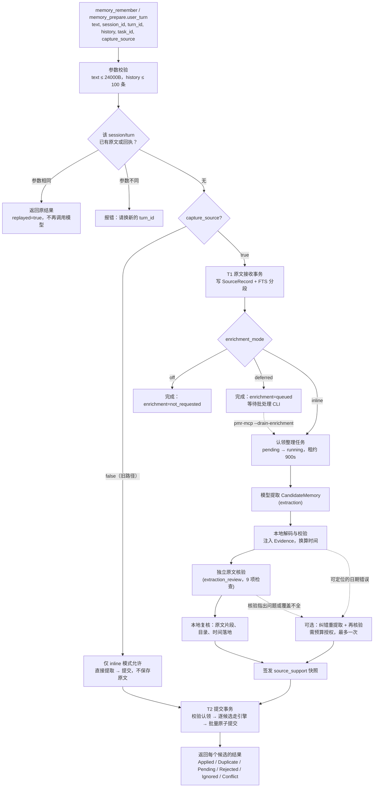
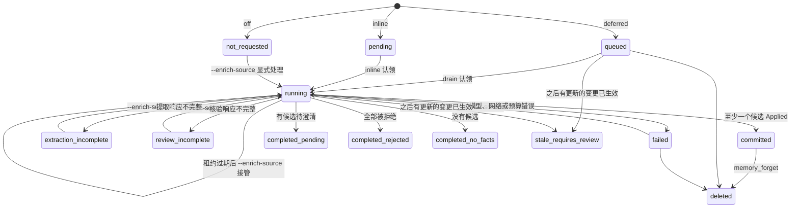
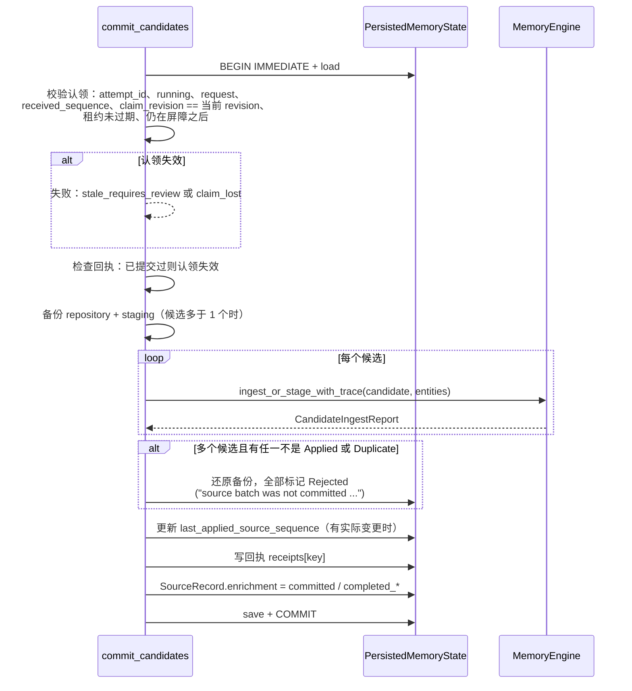
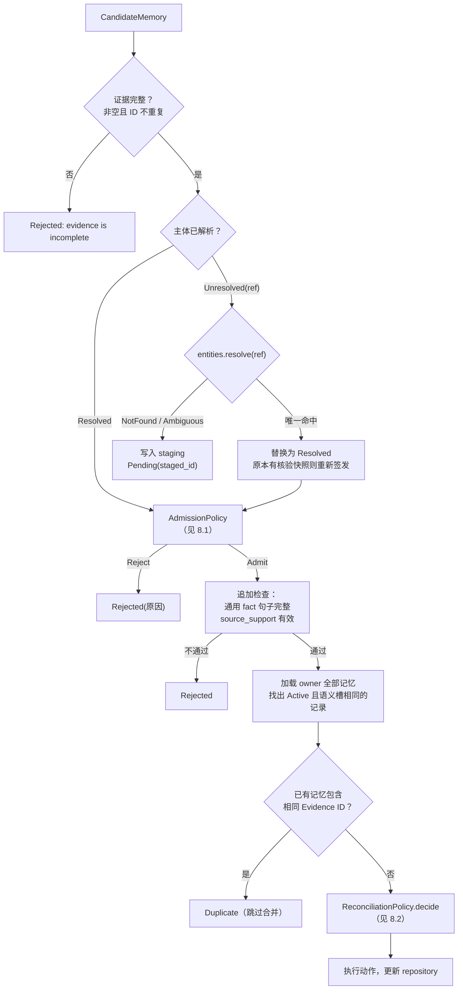

# 新增记忆流程

> 历史文档：下文保留原版本的实现描述、命令及结论，不是当前执行入口。旧写入及 legacy/local/assisted 召回已退出；当前路径、配置、备份与评测见 [架构索引](README.md)。0517000 仅作参考，不是上线门槛。

本文描述一条用户消息如何变成结构化记忆。入口有四个：`memory_remember`、`memory_prepare` 的保存部分、deferred 批处理 CLI，以及 `memory_clarify`。删除（`memory_forget`）放在最后一节。

## 1. 总体流程

两个事务分开，是这条链路最重要的设计：**T1 只负责保存原文**，后面的模型调用或事实提交失败都不会撤销原文；**T2 负责提交事实**。模型网络请求都在两个事务之外执行，不持有数据库写锁。

## 2. 接入层：`memory_prepare` 的异步续等

`src/bin/pmr-mcp.rs` 对 `memory_prepare` 做了特殊处理，因为一次整理可能调用 2 到 4 次模型，容易超过客户端的超时时间：

1. 以完整参数的 JSON 作为任务键，在进程内的队列中查找或新建任务（最多 32 个，完成后保留 600 秒）。
2. 在 `spawn_blocking` 中执行 `ChatMemoryService::call_with_operation("memory_prepare")`。
3. 最多等待 45 秒。超时则返回 `status: in_progress`，客户端必须用**完全相同的参数**再次调用，才能接上同一个任务，而不会重复保存。
4. 拿到结果后调用 `validate_prepare_response`：如果这期间数据库的 revision 变了、原文已被删除，或结果中引用的记忆记录已变化，就丢弃召回部分（`recall.status = not_requested, reason = state_changed_after_prepare`），并重新读取 `global_context`。

进程重启后内存中的任务会丢失，这时依靠已持久化的原文记录和回执保证不会重复写入。

## 3. 参数校验与幂等（`ChatMemoryService::remember`，`src/chat.rs:1974`）

- 幂等键为 `["memory_remember", session_id, turn_id]`。
- 如果 `state.sources` 中已有该键：原文已删除则返回墓碑；参数相同则返回原文状态，并标记 `replayed`；参数不同则报错。
- 如果 `state.receipts` 中已有回执（旧路径处理过的消息）：参数相同时原样返回原结果，这次的 `model_calls` 为空。
- 模式约束：`off` 和 `deferred` 模式必须 `capture_source=true`；`source_capture_enabled=false` 时拒绝保存原文。

## 4. T1：原文接收事务

在一个 `transaction` 中完成以下步骤：

1. 再次检查幂等（拿到写锁后可能已被其他进程处理）。
2. 生成 `SourceRecord`：
   - `id`：新生成的唯一 ID；`received_sequence`：该 owner 内原文编号的最大值加一；`observed_at`：服务端当前时间。
   - `request`：原样保存完整工具参数，包括 `text`、`history` 和 `task_id`。
   - `enrichment` 初始状态由模式决定：off 为 `not_requested`，deferred 为 `queued`，inline 为 `pending`。
   - `task.processing_version = "s5_enrichment_v1"`，`task.accepted_mode` 记录接收时所用的模式。
3. 事务提交前，`lexical::synchronize` 发现新原文，将 `source_revision` 加一，把原文按 768 字符分段（重叠 128 字符）写入 `source_segments` 和 `source_fts`。写入后立即用 FTS 回读验证，再在 `SourceRecord.index` 中写入 `status: ready` 的回执。

off 和 deferred 模式到此返回。inline 模式继续认领任务。

## 5. 认领整理任务（`claim_source`，`src/chat.rs:1521`）

整理任务是一个带租约的状态机，保证同一条原文不会被重复整理，也不会让旧消息覆盖新状态：

认领时：

- 如果 `received_sequence` 不大于屏障 `max(last_applied_source_sequence, source_less_barrier_sequence)`，说明之后已有更新的变更生效，任务直接标为 `stale_requires_review`，不再整理。
- 认领成功时：`attempt_count` 加一，写入新的 `attempt_id`，设置 `lease_until = now + 900s`，`claim_revision` 记录当前 revision，状态改为 `running`。
- drain 模式按 `received_sequence` 从小到大依次处理。遇到预算耗尽，本批次立即停止。

**什么会让排队中的任务失效**：任何改变业务数据、却不来自原文整理的写操作，例如 `memory_clarify`、`memory_entity_upsert`、`memory_forget` 或旧路径的保存，都会把 `source_less_barrier_sequence` 推进到当前最大的原文编号（`src/sqlite.rs:337`）。之后所有排队或运行中的任务都会变成 `stale_requires_review`。这是一个保守的全 owner 顺序屏障。

## 6. 模型提取（`OpenAiMemoryExtractor::extract_turn`，`src/openai.rs:1561`）

### 6.1 请求内容

`OpenAiAdapterContext::request_context()` 生成模型输入：

- 已注册实体目录（ID、名称、别名）、谓词目录（含基数、允许的值类型和记忆类型）、领域目录。
- 当前时间 `now`，也就是原文的 `observed_at`；时区偏移；调用方给出的 `task_id`。
- `session_id`、`turn_id`、`conversation_history`（只用于理解指代）、`current_user_turn`。

输出使用 strict JSON Schema（`personal_memory_candidates_v1`）。实体 ID、谓词、领域都以枚举形式限定在目录内。value 按类型分为 text、integer、boolean、entity_id 四个分支。没有候选时必须给出 `omission_reason`。

### 6.2 本地解码（`decode_extraction_with_feedback`，`src/openai.rs:1240`）

每个原始候选经 `into_domain_with_field` 转为 `CandidateMemory`：

- **注入证据**：`Evidence { id: "{session}:{turn}:{序号}", quote: 当前用户消息全文 }`。模型无法指定证据字段。
- **主体**：`entity_id` 必须在目录内，否则为 `unresolved_reference`（未解析，后续进入待澄清）。
- **时间**：模型只给出时间表达式原文和它理解的日历日期，由 `temporal.rs` 按本地时区确定性地换算，并要求与模型给出的日期一致。“最近”换算为过去 30 天，“下个月”“去年六月”换算为完整自然月，ISO 日期标记为 Explicit。事件相对时间或无法理解的时间保存到 `reference`，不伪造时间戳。留存截止时间通过 `expiry_expression` 单独表达。
- **Scope**：具名字段（companion、geography、country、city、date、time_of_day、activities、task_id）转换为条件集合。country 必须是 ISO 3166-1 代码。task_id 只能是调用方提供的那个值。
- **通用 `fact` 谓词**：value 必须是原文中一个完整的用户句子（`has_complete_fact_value`）。

可定位的日历错误（如模型日期与原文表达不一致）会生成 `feedback`，供纠错重提取使用。其他解码错误直接失败。

### 6.3 独立原文核验（source review）

对解码得到的候选集合，再发起一次独立的模型调用（`personal_memory_source_support_v1`）。输入包括冻结的候选、时间视图，以及一个绑定哈希（`source-review-v3:` 加上下文、候选、原文算出的 FNV 哈希）。模型对每个候选逐项给出 9 个维度的判定：

`subject`、`relation`、`value`、`polarity`、`scope`、`temporal`、`intent`、`source`、`metadata`，每项为 Supported / Contradicted / Insufficient。

同时给出整体覆盖情况 `coverage`：是否已提取当前消息中所有应记住的断言，未覆盖时列出原文片段。

`verify_source_support`（`src/openai.rs:1315`）在本地复核这份核验结果：

1. 绑定哈希必须与当前候选和原文一致。
2. `reviews` 必须一一覆盖每个候选，没有重复的序号。
3. 每个候选再次校验：owner、证据必须来自当前消息或 history、实体、谓词、值类型、记忆类型、领域和 task 都在目录内，通用 fact 句子完整。
4. 核验中引用的每个原文片段，都必须真实存在于当前消息或 history 中。
5. 9 项全部 Supported 的候选，还要满足：有当前消息作为支撑（不能只靠 history）、`observed_at` 等于原文时间，并通过 `temporal_grounding::validate`：时间元数据必须能在原文中与同一断言对上，不接受否定句或他人断言中的日期。
6. 覆盖不完整时，整批失败（`SourceCoverageIncomplete`），不会只提交其中一部分。
7. 全部通过后，对 9 项都 Supported 的候选调用 `bind_source_support()`，签发核验快照。

核验判为不支持的候选不会报错，但没有核验快照，进入引擎后会在准入阶段被拒绝。

### 6.4 可选修复

需要 `model_budget.allow_extraction_repair` 或 `allow_coverage_repair` 授权，且 `max_operation_calls = 4`：

- **纠错重提取**：解码遇到可定位的日期错误，或核验给出具体问题时，带着诊断信息让模型重新完整提取一次，旧候选全部作废，再做一次新的核验。
- **覆盖补全**：核验认为覆盖不完整、但每个候选本身都被支持时，带着遗漏的片段提示重新完整提取一次。

两者共用一次机会。正常流程调用 2 次模型，一次修复共 4 次。

## 7. T2：提交事务（`commit_candidates`，`src/chat.rs:1665`）

**批量原子性**：同一条消息拆出多个候选时，要么全部成功（Applied 或 Duplicate），要么全部不提交。任何一个 Pending、Rejected、Ignored 或 Conflict 都会回滚整批。只有一个候选时不回滚，所以它可以单独进入待澄清。

## 8. 引擎：单个候选的处理（`src/engine.rs`）

### 8.1 准入规则（`DefaultAdmissionPolicy`，`src/policy.rs:51`）

按顺序检查，第一个失败即拒绝，每项都记录在 `IngestTrace.admission_checks` 中：

| 规则 | 通过条件 |
| --- | --- |
| `evidence_complete` | 证据的 ID、session、turn、quote 都非空，且 ID 不重复 |
| `subject_resolved` | 主体已解析为实体 |
| `extraction_confidence` | 不是 Low（用户说得不确定没关系，这项检查的是系统有没有理解对） |
| `user_evidence` | 来源为 UserStatement 或 UserConfirmed。助手推断、假设、控制消息、目标或计划都拒绝 |
| `episode_value` | 仅针对 Episode：有跨轮价值、用户明确要求记住，或是对已有记忆的更正、细化、撤回 |
| `fact_value_representation` | 引擎追加：通用 `fact` 谓词的 value 必须是完整的用户原句 |
| `source_support` | 引擎追加：核验快照与当前候选完全一致。自定义准入策略也不能跳过这项 |

### 8.2 合并规则（`DefaultReconciliationPolicy`，`src/policy.rs:218`）

**语义槽**：owner、subject、memory_type、predicate 相同；Multiple 基数的谓词还要求 value 相同。

| 模型给出的 `intent` | 决策 |
| --- | --- |
| `Ignore` | Ignore |
| `Conflict` | Conflict（不写入） |
| `Refine` / `Supersede` / `Retract`（可带 target） | 在 Active 且同槽的记录中查找（未指定 target 时不能跨 task）：恰好 1 条则执行对应动作；0 条则 Ignore；多于 1 条则 Conflict |
| `Assert` | 在 Active、同槽且 Scope 完全相同的记录中查找：0 条则 **New**；1 条且 value、polarity、strength 都相同则 **Reinforce**；1 条但断言不同则 **Conflict**（单凭值不同，无法区分是现实变化还是纠错）；多条则 Conflict |

### 8.3 执行动作

| 动作 | 对 Store 的修改 |
| --- | --- |
| New | 分配 MemoryId，由候选生成 `Memory`（status Active，计数为 0） |
| Reinforce | 同一轮消息已经支撑过该记录则视为 Duplicate；否则 `reinforcement_count + 1`，合并证据，`certainty` 取较大值，再由留存策略判断是否从 ShortTerm 升为 LongTerm |
| Refine / Supersede | 状态变化（StateChanged）且没有事件相对时间时，新旧版本共用一个切换时间点：优先用用户给出的 `valid_from`，否则用 `observed_at`（来源标记 Supersession）。切换时间与旧版本的有效期矛盾时，改判 Conflict，不修改 Store。否则旧版本 status 改为 Superseded，写入 `superseded_by`、原因和 `valid_to`，并插入带 `supersedes` 的新版本 |
| Retract | 结束旧版本（Superseded，原因 UserRetracted），不生成反向的新记录 |
| Ignore / Conflict | 不修改 |

### 8.4 留存（`DefaultRetentionPolicy`）

留存不是后台任务，而是在召回、列表和 bootstrap 时顺带执行（`run_retention_for_owner`）：

- Active 且 `expires_at <= now` 的非 Durable 记忆改为 Expired，不物理删除。
- ShortTerm 在 `reinforcement_count >= 2` 或用户明确要求记住时升为 LongTerm。
- Durable 不会自动过期，但仍可以被更正、替换或撤回。

## 9. 旧路径：`capture_source=false`

只在 inline 模式下允许。不写 `SourceRecord`，直接调用模型提取和核验，然后 `commit_candidates(claim=None)`。回执写入 `receipts`，重试时原样返回。

- `memory_remember`：即使没有提取到候选，也写回执。
- `memory_prepare`：没有候选或全部被拒绝时不写回执，同一轮消息之后还可以重试。

这条路径不保留原文，所以召回时没有 `source_evidence`，也无法核准答案。

## 10. 结果怎么看

`memory_remember` 的返回（或 `memory_prepare.remember.result`）有两层含义，客户端必须分开判断：

| 字段 | 含义 |
| --- | --- |
| `source.status` | `stored` 表示原文已保存；`deleted` 表示已被删除 |
| `index.status` | `ready` 表示原文已可检索 |
| `enrichment.status` | 整理状态，见第 5 节的状态机 |
| `outcomes[]` | 每个候选的最终结果。只有 `Applied` 算写入成功；`Pending`、`Rejected`、`Conflict`、`Ignored` 都不是 |
| `model_calls[]` | 本次实际发生的模型调用。重放时为空，但这不代表之前的处理没有花费 |

`memory_prepare` 中，如果原文被拒绝或保存失败，就不再执行召回（`recall.status = not_requested, reason = source_not_accepted`）。召回失败也不会撤销已完成的保存。

## 11. 澄清：`memory_clarify`

主体无法唯一解析的候选会以 `Pending(staged_id)` 的形式留在 `staging` 中，其他记录不受影响。之后：

1. 客户端先用 `memory_entity_upsert` 注册用户确认过的实体（如有必要）。
2. 调用 `memory_clarify(staged_id, entity_reference, text, session_id, turn_id)`，幂等键为 `["memory_clarify:{staged_id}", session, turn]`。
3. 引擎（`clarify_staged`，`src/engine.rs:227`）检查：
   - 待澄清候选仍有有效的核验快照；
   - 澄清原话必须明确选中该实体，只接受“X”“我说的是X”“我指的是X”“说的是X”“指的是X”“我是说X”“{原指代}指的是X”这几种形式；
   - 澄清证据不能与已有证据在同一轮消息中相互冲突。
4. 把澄清原话追加为新证据。唯一解析后重新签发核验快照，进入正式的准入与合并流程；成功后移除该待澄清项。如果仍然有歧义，就更新待澄清记录，不会随意选一个实体。

## 12. 删除：`memory_forget`

`memory_id`、`staged_id`、`source_id` 三者只能提供一个，在一个事务内完成：

1. 以给定对象为起点，沿 `supersedes` / `superseded_by` 版本链，以及“证据来自同一轮消息”这两类关系反复扩展，直到没有新的记忆或消息加入。因为整条消息作为一个整体保存，所以删除其中一条事实，会连带删除这条消息及其他派生事实。
2. 对相关的 `SourceRecord`：清空 `request`（删除原文），状态改为 `deleted`，保留墓碑，以阻止重放和迟到的整理任务提交。
3. 删除相关回执；在其他原文和回执的 `history` 中，删除包含被删原文的条目。
4. 删除相关的待澄清候选。
5. 记忆 status 改为 Deleted（软删除），证据引用替换为 `[deleted source]`。
6. `lexical::synchronize` 从 FTS 中删除对应分段。

诊断文件、备份以及 WAL 中的历史页不会被物理擦除，返回结果中会说明这一点。
